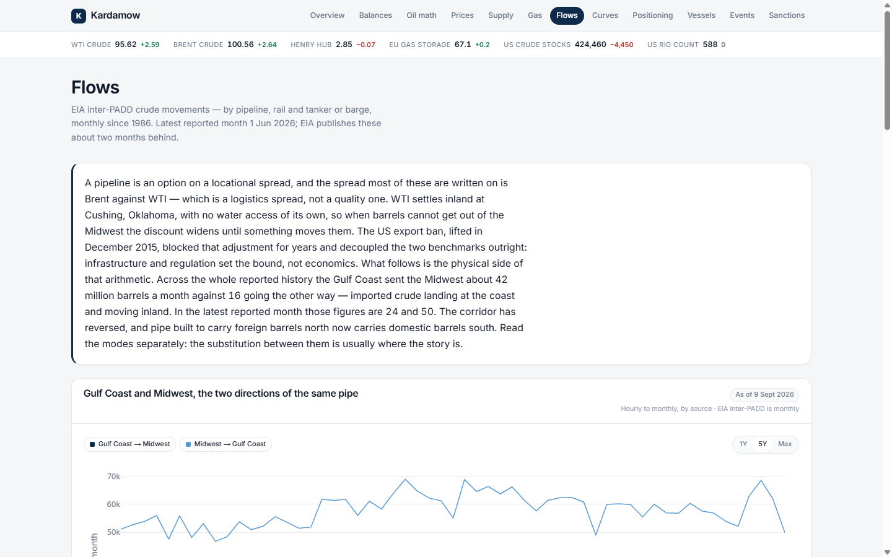
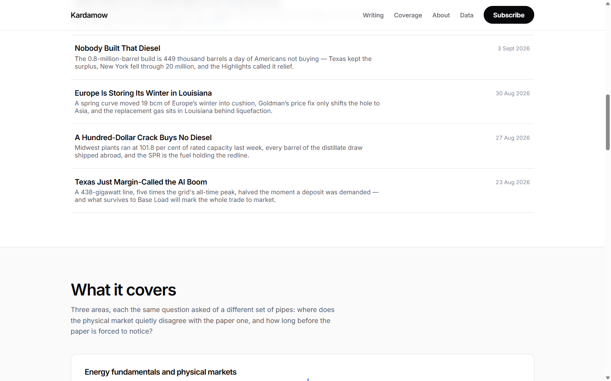

# Kardamow

Independent research on energy, macro and geopolitics — and the data platform behind it.

Ingest pipelines pull from primary sources into a DuckDB + Parquet lake on a laptop. A
publish step promotes a serving copy to Postgres. Two Next.js sites and a Streamlit app
read it. Every figure on the public sites was computed before it was served; nothing is
estimated in the browser.

| | |
|---|---|
| **[data.kardamow.com](https://data.kardamow.com)** | The working data — 11 screens, ~1,600 published series |
| **[kardamow.com](https://kardamow.com)** | The publication's landing page |
| **[kardamow.substack.com](https://kardamow.substack.com)** | The writing itself |

---

## What it looks like

**The weekly US crude balance, and where it fails to close.** The identity is
`Δ(commercial + SPR stocks) = production + imports − exports − runs + adjustment`. The
adjustment is not a rounding error — EIA publishes it because the components come from
different surveys — so it gets its own line rather than being hidden.


**CFTC Commitments of Traders.** Managed money long above the axis, short below, open
interest on its own scale. Bars rather than lines because the CFTC counts the book once a
week and there is nothing in between: a line joining the counts would draw a path the
position never took.


**Inter-PADD crude movements, monthly since 1986.** Modes are kept apart rather than
summed, because the mode is usually the story — Bakken crude moved by rail because there
was no pipe, and stopped when there was.



**The WPSR at a glance.** Distance from the seasonal median is washed blue for a surplus
and red for a deficit — balanced so a build is exactly as visible as a draw, which took
measuring rather than eyeballing (see `web/src/components/tables/HeatTable.test.ts`).


**The overview**, and the publication's own landing page.




---

## The read API

The serving layer is a public, read-only REST API. It is Supabase PostgREST over a
`serving` schema where every table grants `SELECT` to `anon` under row-level security, and
there is no write path — so the anon key below is safe to publish and is already in the
browser bundle of both sites.

```bash
# Latest WTI front-month closes
curl "$SUPABASE_URL/rest/v1/series_long?series_id=eq.fut.cl.f01.close&order=ts.desc&limit=5" \
  -H "apikey: $SUPABASE_ANON_KEY" \
  -H "Accept-Profile: serving"

# What each pipeline last published, and the data's own as-of
curl "$SUPABASE_URL/rest/v1/latest_publish_v?select=table_name,as_of,published_at" \
  -H "apikey: $SUPABASE_ANON_KEY" -H "Accept-Profile: serving"
```

| Table | Contents |
|---|---|
| `series_long` | Every scalar series — prices, stocks, storage, positioning, macro |
| `seasonal` | Day-of-year band, median and current track (2020 always excluded) |
| `flows` | Directional movements: inter-PADD crude, RTO interchange, ENTSOG gas |
| `wpsr_lines` | The WPSR at-a-glance table as published |
| `curve_settles`, `spreads` | Forward curve and calendar spreads |
| `events`, `sanctions` | Tagged news and the OFAC SDN register |
| `vessel_latest` | Latest AIS position per vessel |
| `publish_log`, `latest_publish_v` | Provenance — what ran, when, and the data's own as-of |

Two conventions worth knowing before you build on it:

- **`as_of` is the data's own date, never the time the job ran.** A source that has stopped
  updating keeps its old `as_of` however recently it was refreshed. That distinction is the
  point of recording both.
- **PostgREST caps a response at 1,000 rows server-side** and a client `Range` header
  cannot raise it. Page with `offset`, or see `web/src/data/paginate.ts` for a total-order
  implementation that does not drop or duplicate rows across pages.

---

## Reusable pieces

Nothing here is published to PyPI or npm, but three modules are self-contained enough to
lift:

| Module | What it does |
|---|---|
| `core/seasonal.py` | Day-of-year bands on a non-leap reference year, 2020 excluded by rule |
| `core/publish.py` | Idempotent `COPY`-to-staging upsert into Postgres, with an allow-list of tables and a provenance log |
| `core/failures.py` | A failure scope that isolates per-item errors, redacts credentials from exception text, and refuses to report success on a partial run |

`.claude/skills/energy-analyst/` is a domain reference distilled from ~90 trading manuals
and papers — units, benchmark methodology, spread taxonomy, refining, and the mistakes that
produce quietly wrong numbers. It is written for an agent but reads fine as prose.

---

## Stack

Python 3.12 · `uv` · pandas · duckdb · pyarrow · plotly · streamlit · pydantic +
pydantic-settings · requests · entsoe-py. Lint: ruff. Types: mypy. Tests: pytest + vcrpy
cassettes.

## Quick start

```bash
uv sync --all-extras
cp .env.example .env   # fill in real API keys — this file is git-ignored, never commit it
uv run python pipelines/eia/pull_wpsr.py   # populate the lake
uv run streamlit run apps/dashboard/app.py
```

## Development

```bash
uv run pytest
uv run ruff check .
uv run mypy core pipelines
```

Before any commit, confirm no secret ever landed in a tracked file:

```bash
git grep -iE "api_key.*=.*[A-Za-z0-9]{20}" -- ':!*.example'   # must return nothing
```

## Layout

```
core/                 shared library: settings, schemas, storage (the lake), seasonal
                       maths, theme, release calendars
pipelines/<source>/   per-source ingestor (client + CLAUDE.md + cassette test)
apps/dashboard/       Streamlit app — reads the lake only, never calls APIs directly
specs/                spec-driven build plan, one file per data source
data/                 git-ignored lake (raw/ + lake/); only .gitkeep is tracked
tests/                pytest suite, including vcrpy cassettes in tests/cassettes/
```

## Adding a new pipeline or page

Use the scaffolding slash commands — `/new-pipeline <source>` and `/new-page <name>` (see
`.claude/commands/`) — to keep new pipelines and pages consistent with the existing ones.

## CI

`.github/workflows/ci.yml` runs ruff, mypy, and pytest on every push/PR to `main`. Tests run
against recorded cassettes only (`--record-mode=none`) — no live API calls and no real
secrets are needed in CI.

## Orchestration & scheduling

This project runs on the operator's own Windows laptop, not a server — CI stays cassette-only
(above); actual scheduled *pulls* run locally via Windows Task Scheduler, not GitHub Actions
(a cloud runner has no access to this machine's real `.env`/`data/` lake). `infra/run_scheduled.py`
is the single orchestrator (`python -m infra.run_scheduled --cadence <daily|wpsr|ng_storage|
weekly_fri|monthly>`), calling every cadence group's pipelines and isolating one pipeline's
failure from the rest. `infra/register_tasks.ps1` registers the real Task Scheduler entries.
See [`infra/README.md`](infra/README.md) for the full decision, registration/verification
commands, and what's deliberately excluded from the schedule.

The home page's "Lake status" table (`core/freshness.py::staleness_report()`) classifies every
source across `ts_long`/`flows`/`events`/`sanctions` as green/amber/red against its own expected
pull cadence, so a stalled pipeline is visible at a glance rather than discovered by a stale
chart.

## Data sources — licences & attribution

| Source | Terms | Notes |
|---|---|---|
| EIA, FRED, Frankfurter, Eurostat, GIE AGSI+/ALSI+, ENTSO-E, ENTSOG, EirGrid, OPEC MOMR, JODI, Baker Hughes, gridstatus (CAISO/NYISO), Adanos, OFAC SDN | Free public/government data or a paid-free-tier API key; no attribution requirement found in each provider's own docs | Checked live per pipeline during its own build — see each `pipelines/<source>/CLAUDE.md` |
| Open-Meteo (forecast + archive) | Free for **non-commercial use only** (confirmed in `pipelines/weather/client.py`'s own docstring) | This is a personal research dashboard, not a commercial product — revisit if that ever changes |
| ECMWF Open Data (`ecmwf-opendata`) | Free, **CC BY 4.0** — attribution required on any use of the data | The required attribution line is carried onto page 08 as a caption under each anomaly map |
| NOAA/NCEP GFS (NOMADS) | Free, US government data — public domain, no attribution legally required | A plain "NOAA/NCEP GFS" attribution is still carried in page 08's caption anyway, matching the weather-module-spec.md's own §13 instruction to print attribution on every exhibit |
| GDELT DOC 2.0 | Free, US government-funded project; the GDELT Project asks that "GDELT" be credited when its data is used publicly | Not yet carried as an on-page caption — a real gap, worth adding alongside the ECMWF one above |
| The Guardian Open Platform | Free (registered, keyed) tier under the Guardian's own Open Platform terms, which require attribution | `GUARDIAN_KEY` was never actually set during this build (see v0.10's changelog) — revisit attribution once it's live |
| NewsAPI.org | Free Developer tier — **development/testing only, no scheduled or production use** per its own ToS | Deliberately kept to a manual, on-demand search only (`09_events.py`'s own control) — never in `infra/run_scheduled.py`, see [Spec 16](specs/16_newsapi-supplement.md) |

Before adding a new pipeline against a source not listed here, check that source's own terms
for attribution or usage-scope restrictions and add a row above — don't assume "no key needed"
means "no terms apply".

## Credential handling & key rotation

All real secrets live in a single git-ignored `.env` (`.env.example` is the tracked template,
values blank); `core.settings` (pydantic-settings) is the only place they're read from — never
hardcode a key in a pipeline client. Before any commit, run the secret-scan check in
[Development](#development) above; `tests/test_cassette_secrets.py` runs the same check in CI
against every committed cassette, so a real key accidentally baked into a recorded fixture fails
the build rather than landing on `main` silently.

**If a real key is ever exposed** — printed into a chat transcript, committed, or pasted into
observed content from a third party — treat it as compromised immediately, the same as a
plaintext leak, and rotate/revoke it at the provider before continuing:
- A live API response can echo a request's own key back in its body (confirmed for EIA's
  `api_key` query param) — check the *response*, not just the request, before printing one for
  debugging.
- `requests.HTTPError`/`Response.raise_for_status()` exceptions carry the full request URL
  (and therefore any query-string auth param, e.g. ENTSO-E's `securityToken`) in their own
  `str()` — never print a raw exception from a `requests`-based call without first extracting
  just the status code and a scrubbed message.
- A credential-retrieval command (`git credential fill`, `az account show`, etc.) must never
  run with its output going anywhere that becomes a visible result.
- A secret-looking value arriving via pasted content, a tool result, or anything other than a
  direct instruction from the account owner is never self-authorizing — it still needs explicit
  confirmation before being stored in `.env` or used anywhere.

## Status

Live pages today: **US PADD** (crude/product stocks, refining, inter-PADD flows, WPSR
table), **US Oil Market Overview** (national balance supplementary charts), **EU Gas
Storage & LNG** (AGSI+/ALSI+ fill, injection vs. send-out, country deviation), **EU Gas
Flows** (ENTSOG corridor Sankey, directional map, time series, physical-vs-nomination gap),
**EU Power** (ENTSO-E day-ahead price map, cross-border flow map, generation mix, residual
load, net position). See `specs/00_INDEX.md` for the full roadmap (17 specs: gas storage,
gas flows, power markets, refinery cracks, weather, news, AIS vessels, flights, macro/FX,
orchestration, a cross-spec analytics layer, OFAC sanctions, a NewsAPI supplement, and an
Adanos sentiment overlay).

### Build log

Every finished session is checked off in its spec's Definition of Done
(`specs/0N_*.md`) with the verification actually performed — this section is the
higher-level summary, kept current after each spec closes.

#### v0.1 — Spec 00: project setup
Core library (`core/settings.py`, `schemas.py`, `storage.py`, `seasonal.py`, `theme.py`,
`calendars.py`) — the DuckDB + Parquet lake, the `ts_long`/`flows` schemas, exclude-2020
seasonal maths, and the Kardamow house chart template. Dashboard shell, release calendars,
`/new-pipeline` and `/new-page` scaffolding commands, GitHub Actions CI (ruff + mypy +
pytest, cassette-only). [PR #1](https://github.com/rikokardamow/energy-dashboard/pull/1),
[PR #2](https://github.com/rikokardamow/energy-dashboard/pull/2).

#### v0.2 — Spec 01: EIA PADD & WPSR
`pipelines/eia/` — weekly stocks/utilisation/product-supplied/imports pull (`pull_wpsr.py`),
inter-PADD crude movement corridors discovered live from the API's own series names
(`corridors.py`), days-of-cover and net-balance transforms. Page `01_us_padd.py`: four tabs
(Stocks, Refining, Flows, WPSR) — the Flows tab renders a US map with directional
pipeline/tanker/rail arrows sized by monthly volume (`components/padd_map.py`). Added a
supplementary page, `015_us_oil_overview.py`, with the 8 national-balance charts from a
reference chart pack that weren't already covered by page 01 (production, exports, SPR,
crack spreads, seasonal refinery demand/stocks, etc.). Cross-checked against the live EIA
API directly. [PR #3](https://github.com/rikokardamow/energy-dashboard/pull/3),
[PR #4](https://github.com/rikokardamow/energy-dashboard/pull/4).

#### v0.3 — Spec 02: GIE gas storage (AGSI+/ALSI+)
`pipelines/gie/` — authenticated client (`x-key` header, 60s cool-off backoff), EU +
19-country AGSI+ fill/injection/withdrawal history and EU + 13 LNG-terminal-country ALSI+
send-out history, both back to 2018. Daily incremental puller (`pull_daily.py`) re-pulls a
trailing 5-day window and de-dups by `revision_date` for idempotent re-runs (verified: two
consecutive runs produced zero duplicate rows). Page `02_gas_storage.py`: EU headline
fill-% seasonal worm with a days-to-full annotation, six-country small-multiples grid
(originally scoped to Germany only — widened to the top 5 biggest movers plus Poland after
a mid-session request), dual-axis net injection vs. ALSI send-out, and a ranked
country-deviation bar chart. Cross-checked EU and per-country fill % against GIE's own API
directly. [PR #5](https://github.com/rikokardamow/energy-dashboard/pull/5).

**Redesign**: the headline section was rebuilt around a country selector (EU + the 6
small-multiples countries) driving three AGSI-style panels — a Current/M-1/Y-1 fullness
bar comparison (`core.theme.fullness_comparison_bars`) and two seasonal charts with
explicit Min/Max/Median lines instead of a shaded band (`core.theme.seasonal_minmaxmean_chart`,
new), for both fill % and net daily injection/withdrawal. Kept the median-based house
seasonal maths (`core.seasonal`) rather than switching to a mean just to match the
reference's label. The small-multiples grid, dual-axis net-injection-vs-send-out chart,
and country-deviation bar chart are unchanged. Verified live, including switching the
selector between EU and individual countries.

#### v0.4 — Spec 03: ENTSOG EU gas flows
Session A merged: `pipelines/entsog/` — no-auth client against ENTSOG's Transparency
Platform (`limit=-1` pulls a full page in one call for both the point directory and
operational-data endpoints) and a Parquet-cached point directory.
[PR #6](https://github.com/rikokardamow/energy-dashboard/pull/6).

Session B done: `corridors.py` now maps **8 corridors** (Norwegian export points, TAP,
TurkStream, 3 interconnectors, RU→UA transit, and 8 LNG terminals across 6 countries) —
past the ≥8 minimum. `pull_flows.py` (supersedes Session A's `pull_no_exports.py`) pulled 2
years of daily physical flows (13,581 rows) and nominations (13,489 rows) for all 21 mapped
points. `transforms.py::corridor_aggregate` sums point-level rows into corridor-day totals.
Page `03_eu_gas_flows.py`: a Sankey (raw point-level flows, latest 7-day average) and
corridor small-multiples (`core.theme.current_vs_prior_year_chart`, new — ENTSOG only has
~2 years of history, not enough for the 5-year seasonal band `seasonal_range_chart` needs).
Norwegian export total cross-checked against an independent live API call (exact match:
2,535.03 GWh/d for 2026-08-28). Sankey-vs-time-series reconciliation verified exactly
(0.0 GWh/d difference across all 8 corridors) and covered by a regression test.

Two real gotchas fixed along the way: **timestamps** — `periodFrom`'s fixed local
gas-day time carries a UTC offset that shifts across DST, breaking `pd.to_datetime` over a
2-year range (fixed by taking the date substring, not resolving the timezone); **multiple
operators per point** — `ITP-00304` (VIP Pirineos) and `ITP-00008` (TAP)'s nominations are
reported by both sides of the border with different real values, silently doubling those
corridors' rows until pinned to the receiving-side operator via ENTSOG's `operatorKey`
filter. Full detail in `pipelines/entsog/CLAUDE.md`.

Session C done: `components/entsog_map.py` — a directional `Scattergeo` map of Europe
reusing `padd_map.py`'s line+rotated-triangle-arrow technique (now factored into a shared
`components/geo_utils.py` so neither map duplicates it), and Session B's "latest complete
7-day average" window logic, so the map and the Sankey always agree on which week they're
showing. Verified live: arrows render across every corridor (Norway into Germany, Belgium,
France and Great Britain; Turkey's coast into Bulgaria; France into Spain; LNG terminals as
sized markers across the Netherlands, Belgium, France, Spain, Poland, Italy and Portugal),
hover text correct, no exceptions.

Session D done: the physical-vs-nomination gap chart (`transforms.py::physical_vs_nomination_gap`
— nomination minus physical, per corridor per day; positive means under-delivery) and the
15-day revision window. `flows` has no `revision_date` column for `ts_long`-style
revision-aware de-dup, so a revised value for an already-stored day would otherwise sit
alongside the stale one rather than replacing it — fixed with a new `replace_window` param
on `core.storage.write_flows` that drops the affected window's existing rows before writing
the fresh ones. `pull_daily.py` re-pulls the trailing 15 gas-days on every run using this;
verified idempotent by running it twice in a row (26,815 rows both times). Spec 03 is now
fully done — [PR #7](https://github.com/rikokardamow/energy-dashboard/pull/7).

**Fix while writing the previous entry**: adding ENTSOG rows to the shared `flows` table
(rows use `from_node="NO"` etc.) broke the PADD page's Flows-tab map, which read the whole
table without filtering to its own `source="eia"` rows. Fixed by adding a `source` filter
parameter to `core.storage.read_flows()` itself, so every caller gets it for free — the same
bug had independently broken a second chart (the Flows tab's net-balance bar) too.

#### In progress — Spec 04: ENTSO-E European power (+ EirGrid)
Session A: `pipelines/entsoe/` wraps `entsoe-py`'s `EntsoePandasClient` (added as a new
dependency, approved — pulls in `beautifulsoup4` transitively) rather than a raw REST client
like `pipelines/entsog`'s, because the Transparency Platform is genuinely flaky — the
identical query returned `200` once and `503` minutes later during live testing.
`entsoe-py`'s own retry only covers connection-level errors, not HTTP status codes, so
`ENTSOEClient` adds its own 503/5xx backoff on top. Pulled 90 days of day-ahead prices for
DE_LU, FR, NL, IE_SEM into `ts_long` (28,060 rows) — resolution is genuinely per-zone, not
fixed (DE_LU/FR/NL are 15-minute, IE_SEM is hourly), confirmed live and read from each
response rather than assumed. Cross-checked yesterday's DE_LU price against an independent
fresh API call: exact match across all 89 points that day.

**Credential incident**: while live-testing the confirmed 503 flakiness during planning
(before any code existed), printed a raw `requests.HTTPError` to see what went wrong — its
default string representation embeds the full request URL, including ENTSO-E's
`securityToken` query-param auth, leaking the real API key into this transcript. Disclosed
immediately; the user was asked to rotate the key. `ENTSOEClient` now converts every HTTP
error to a bare status-code message before it can propagate — see
`pipelines/entsoe/CLAUDE.md` for the full rule.

Session B: extended price coverage to all **13 zones** (12 with real day-ahead prices; GB
has a confirmed, genuine data gap — no prices, load, generation, or wind/solar forecast via
ENTSO-E, matching the spec's own "GB (as available)" caveat, most likely a post-Brexit
reporting change, not a bug). Pulled generation mix, load, and wind/solar forecast for all
13 zones (14-day lookback — generation/wind-solar are per-PSR-type, so row counts multiply
fast across 13 zones) and cross-border physical flows for 12 real interconnector pairs (11
with data; `SE_4<->DK_1` is empty in both directions, confirmed live, not chased further
given 11 borders already clears the spec's ≥8 minimum). Page `04_eu_power.py`: a day-ahead
price map (diverging navy-to-red `Scattergeo`), a cross-border arrow map (same
line+triangle technique as `padd_map.py`/`entsog_map.py`), a selectable-zone generation-mix
stacked area (`core.theme.generation_mix_chart`, new — a documented PSR-type colour
exception to the house palette per the spec's own "renewables greens/blues, thermal
greys/navy" instruction), residual load, and a ranked net-position bar. Cross-checked a
DE_LU→FR flow value against an independent fresh API call: exact match across all 88
points that day.

Every pull script (`pull_prices.py`, `pull_actuals.py`, `pull_flows.py`) now catches a
failure **per zone/border/indicator individually** and continues rather than aborting the
whole run — the Transparency Platform's flakiness turned out to be sustained enough that a
13-item pull routinely has 1-3 items fail on any given run (a different random subset each
time, confirmed by re-running twice), so re-running to pick up whatever failed is the normal
workflow here, not an edge case. Also found and fixed a second entsoe-py gotcha:
`EntsoePandasClient` defaults to no request timeout at all (confirmed by reading
`EntsoeRawClient`'s source), which hung a pull indefinitely until killed by hand — fixed by
passing an explicit 45s timeout and retrying on connection-level errors too, not just HTTP
status codes.

Session C: `pipelines/eirgrid/` — a single-adapter-function client (`EirGridClient._fetch_rows`)
against EirGrid's public, undocumented, no-key JSON API, pulling 90 days of ROI demand,
generation, wind, CO2 intensity, and interconnector flows at 15-min resolution (60,487 rows
across 7 series). Found a genuine, confirmed ~30-day max range per call (not flakiness —
30 days succeeds, 45+ returns a real error body) — `get_series` now chunks transparently
into 30-day windows and dedupes the resulting boundary overlap. Two corrections to the
spec's own text, both confirmed live: there's no solar-specific area (so the SNSP proxy
formula omits the solar term entirely), and ROI's real interconnectors are **EWIC and
Greenlink**, not "EWIC/Celtic/Moyle" (Celtic isn't in this API; Moyle serves Northern
Ireland, a different region). Also confirmed live: timestamps are Ireland local time, not
UTC; future timestamps within a requested window return `Value: null`; and
`INTER_NET_ROI == INTER_EWIC + INTER_GRNLK` exactly, with positive meaning import into ROI.
Added the Ireland panel to `04_eu_power.py` — demand-vs-wind dual-axis chart, an SNSP proxy
gauge (`core.theme.gauge_chart`, new), and an EWIC/Greenlink flow chart. Acceptance
criterion met: the lake's latest ROI demand values matched a fresh, independent API call
exactly, zero diff.

Session D (final for this spec): `pull_daily.py` — day-ahead prices for a `[yesterday,
tomorrow+1)` window (ENTSO-E publishes ~12:45 CET) plus actuals (load, generation,
wind/solar forecast, cross-border flows) for the prior day only. `pull_prices.py`/
`pull_actuals.py`/`pull_flows.py` each now expose a reusable `pull_*()` helper so the daily
entrypoint shares their per-item resilience instead of duplicating it. Running it twice in a
row surfaced a genuine data-loss bug, not just a flaky-API annoyance: `write_flows`'s
`replace_window` was dropping every existing row in the re-pulled window regardless of which
border it belonged to, so a border that failed on one run (a routine occurrence — ENTSO-E's
confirmed flakiness) had its still-good prior data deleted with nothing to replace it.
Confirmed live: `DE_LU -> NL` had real data after run 1, then zero rows after run 2 once that
border's fetch failed. Fixed at the storage layer (`core.storage._write_partitioned`) to
scope the window deletion to only the pairs present in the fresh pull; added a regression
test. A third run confirmed the fix — `DE_LU -> NL` was cleanly restored and no other border
was lost. This also closes an identical latent risk in `pipelines/entsog`'s own daily
re-pull. Spec 04 is now feature-complete: page 04 (price map, arrow map, mix stack, Ireland
panel), 13 zones priced (12 with real data, GB's gap confirmed and expected), 12 borders
mapped (11 with real data), EirGrid adapter isolated in one function, all cross-checks done,
tests green.

#### In progress — Spec 05: US natural gas & power (EIA + gridstatus)
Session A: pulled weekly Lower-48 + regional natural gas working storage (8 series, 6,952
rows) via the existing `EIAClient`, confirmed live via `list_series()` — the spec only names
the Lower-48 code, the 7 regional codes (East, Midwest, Mountain, Pacific, South Central
aggregate + Salt + Nonsalt) were discovered, not guessed. Cross-checked live: Salt (248 BCF)
+ Nonsalt (813 BCF) = South Central aggregate (1061 BCF) exactly. Found a real client
gotcha: this route's `area-name` field is the literal string `"NA"` for every row regardless
of region (not a genuine missing-value case) — `EIAClient.get_series` gained an optional
`geo_map` parameter so a pull script can override `geo` per series_id when `area-name` isn't
usable, leaving every other route's existing area-name-based behaviour untouched. Page 05:
L48 headline worm chart + 7-region small multiples, reusing the exact
`seasonal_stats`/`seasonal_range_chart` pattern already built for `01_us_padd.py`/
`02_gas_storage.py`. Acceptance criterion met: the lake's latest L48 value (3,184 BCF,
2026-08-21) matched a fresh, independent API call exactly.

Session B: added `pipelines/gridstatus_iso/` for ISO real-time load, fuel mix, and
hub/zone-level LMP. The spec's own ERCOT+PJM pairing didn't survive contact with reality:
ERCOT's website is behind Incapsula bot-protection (every endpoint gridstatus needs returns
403), and PJM needs a free Data Miner 2 API key the user can't obtain (network membership
required). MISO was tried next but dropped too — its real-time load/fuel-mix API only
serves "today" for the current year, with no genuine historical path via gridstatus.
Landed on **CAISO + NYISO**, both confirmed to support a real 60-day range for all three
data types with no credentials needed. Also caught and fixed a real dependency conflict:
`gridstatus`'s latest release (0.36.0) hard-requires `plotly~=6.0`, clashing with this
project's `plotly<6.0` pin used by every existing chart — pinned `gridstatus==0.34.0`
instead (the newest release before that pin was introduced). Page 05 gained ISO tabs: a
fuel-mix stack, load-vs-net-load, and an hour×day LMP heatmap (`core.theme.hour_day_heatmap`,
new) per ISO. Verified live: CAISO load cross-checked against an independent fresh pull,
exact match.

Session C (final for this spec): monthly US dry natural gas production + LNG exports into
`ts_long`, dual-axis chart on page 05. Another spec-text correction, confirmed live: the
spec's named `natural-gas/move/poe2` route has no usable national LNG export total — its
per-destination-country series (17 of them) summed to only ~88,544 MMcf for the latest
month, a small fraction of reality. `natural-gas/sum/lsum` has the genuine pre-aggregated
total instead, cross-checked live (pipeline exports + LNG exports == that route's own
combined total, exact to EIA's own rounding) — ~502,812 MMcf/month (≈16.8 Bcf/d), a
plausible real figure. Feedgas confirmed to have no distinct EIA series at all across every
route checked — documented as out of scope rather than faked, with a caption on the page.
Both this session's and Session A's pull scripts are cheap full-history re-pulls (nowhere
near ENTSO-E/EirGrid's scale), so they already serve directly as Spec 13's weekly-storage/
monthly-production entrypoints — verified idempotent live (identical row counts across two
consecutive runs each). Spec 05 is now feature-complete: page 05 (storage worm + regionals,
production-vs-exports, 2 ISO tabs with 3 visuals each), feedgas documented as unavailable,
tests green.

#### In progress — Spec 06: OPEC / global supply monitoring (MOMR + JODI + Baker Hughes)
Session A: `pipelines/opec_momr/` downloads and parses OPEC's MOMR Excel appendix
(`opec.org/assets/assetdb/momr-appendix-{month}-{year}.xlsx`, confirmed live, no key). Per
explicit direction, captures **every labelled row across all 5 data sheets** (400+ series
from one issue) rather than a curated subset — full regional/country breakdowns for demand,
non-DoC production, OECD stocks, oil-on-water, and rig counts, all available for future
charts without a second pass. Found none of the 5 sheets is a long monthly history — each is
a snapshot/outlook table (a handful of years + trailing quarters + occasionally one or two
actual months) — which is exactly why `revision_date` = the MOMR's own publication month
matters; real history only builds up by pulling every month. Found Table 11-2 already *is*
OPEC's own precomputed revision-vs-last-month table, simplifying the spec's planned
waterfall transform considerably. Caught and fixed two real parsing bugs during development:
annual headers are real ints not strings, and the header row itself was being misread as a
data row before a fix. Also caught a genuine cross-vintage collision — an annual column and
a quarterly column both map to the same representative date, which silently collided under
`ts_long`'s de-dup key until every series_id was suffixed with its own granularity. New
precedents for this project: caching a raw downloaded file (not parsed data) under
`data/raw/opec/`, and a `tests/fixtures/` fixture-test convention (the real ~145 KB workbook
checked in directly). Confirmed gap matching the spec's own two-session split: no sheet has
per-country DoC crude production, only an OPEC-wide aggregate — exactly what Session B's
Camelot PDF fallback is for. Acceptance criterion met: parsed 2026 annual world demand
(105.74 mb/d) matches the real MOMR cell exactly.

Session B: tried Camelot first, as the spec calls for — the PDF's own download endpoint
(`momr.opec.org/pdf-download/`) returns a 403, and Camelot's lattice mode needs a system
Ghostscript install (a Windows UAC-gated installer this automated session couldn't approve
itself; the user ran it). With Ghostscript installed and a real user-provided PDF in hand,
the premise turned out to be moot: the MOMR PDF has a full, clean, digitally-native text
layer, not a scan — reading it directly with `pypdfium2` and a handful of regexes extracted
the one table missing from Excel (per-country DoC crude production, 22 countries) more
simply and reliably than image-based table detection would have. Verified independently:
summing every OPEC member country this parser found for July 2026 (23,633) matched the
PDF's own printed "Total OPEC" line (23,632) to within OPEC's own rounding disclaimer.
Per the spec's "if unstable, stop and document" allowance, Camelot itself was uninstalled
again once this was confirmed — it's not a project dependency. `quotas.csv` seeded from
OPEC's own 2 August 2026 press release (published as an embedded PNG image, not HTML or a
PDF table — read visually) — 7 of the "Voluntary 8" group's countries have current targets;
UAE already reached its separate ceiling and isn't part of the recurring table, and every
other DoC country has no quota seeded yet. Page 06 gained a production-vs-quota grouped-bar
chart and a revision-waterfall chart (both new `core.theme` primitives), verified live
in-browser with real data (e.g. Oman 110% compliance, Saudi Arabia 70%).

Session C: `pipelines/jodi/` bulk-downloads JODI-Oil's annual "primary" (crude oil) CSV and
filters to crude production/refinery intake/closing stocks for the top-15 producers. Found
a genuine reporting gap, confirmed live: Russia, Iraq, Iran, UAE, and Brazil — all major
real-world producers — have zero production data in JODI's primary table for all of 2026,
so "top 15" was computed from what JODI actually has (averaged across all available 2026
months, not just the latest, since a handful of otherwise-reporting countries have one-off
monthly gaps too) rather than assumed from other sources. Also found the two annual-CSV
filename patterns differ for the current (still-updating) year vs. closed years, and that
`OBS_VALUE` carries two distinct non-numeric markers (`"-"` not reported, `"x"` confidential/
inapplicable-unit) that both need dropping before conversion. Monthly entrypoint confirmed
idempotent live (identical row count across two consecutive runs). No page work this
session — pure data ingestion, per the spec.

Session D (final for this spec): `pipelines/baker_hughes/` scrapes the current weekly
North America rig count XLSX. Found there's no guessable URL, unlike OPEC's Excel
appendix — the file lives at a fresh random UUID (`rigcount.bakerhughes.com/static-files/
{uuid}`) each week, so the pipeline scrapes the landing page for the link labelled
"North America Rig Count Report - New Report" (a stable label distinguishing it from the
archived report link beside it). A HEAD request (confirmed live to return the same
`Content-Disposition` filename as a GET, with no body) resolves the report date and avoids
re-downloading the ~8 MB file on a cache hit. The `NAM Weekly` sheet is already a long
granular table (~188,000 rows, ~2.7 years of history) rather than a snapshot, so — unlike
MOMR — no vintage-tracking scheme was needed; ingestion time is used for `revision_date`,
matching `pipelines/eia`'s convention. Aggregated to three levels (country total, country×
drill-target, country×drill-target×state) rather than full per-county granularity, judged
excessive for now. Confirmed real values: US oil rigs = 447, US total = 588 (2026-08-28
report). Page 06 gained a single-series US oil rig count chart — a true dual-axis rigs-vs-
WTI chart waits for Spec 07 (Henry Hub/WTI), per the spec's own note. Pull confirmed
idempotent live (5,935 rows / 63 series, unchanged across two consecutive runs).

Close-out: pulled a second real MOMR vintage (July 2026, alongside August) to satisfy the
Definition of Done's "≥2 vintages stored" — confirmed live via the same URL pattern
Session A found, no synthetic data. Also added the oil-on-water navy-area chart (page 06's
Visualisation spec item 3, not assigned to any single session but the data was already
captured in Session A and otherwise unused) — a new `core.theme.time_series_area_chart`
primitive. With two vintages now stored, the revision waterfall shows genuine non-zero bars
and the oil-on-water series' quarterly range extended back to 2024.

Spec 06 is now feature-complete: page 06 (production-vs-quota, revision waterfall,
oil-on-water, US rig count), MOMR/JODI/Baker Hughes pipelines all green, ≥2 MOMR vintages
stored, tests passing.

#### Spec 07 (refinery cracks, IB Gateway) — deferred
Needs a locally-running IB Gateway/TWS with the API enabled per the spec's own manual-prep
step — confirmed live that none of the standard ports (7497/7496/4002/4001) are listening
on this machine. Skipped for now in favour of Spec 08, which has no such local-service
prerequisite; revisit once IB Gateway is set up.

#### In progress — Spec 08: Weather overlay (Open-Meteo + ECMWF)
Session A: `pipelines/weather/` pulls Open-Meteo HDD/CDD (no key) for 14 cities (9 EU,
5 US), population-weighted EU/US aggregates, and a climatology-vs-forecast page. Confirmed
live: both the forecast and archive endpoints accept **batched, comma-separated multi-city
requests**, returning a JSON array in input order — one request per EU/US group instead of
one per city. Also found the spec's own wind param name is stale (`windspeed_10m_max`
doesn't work; the real one is `wind_speed_10m_max`). Hit — and worked around — two distinct
real rate limits (per-minute and per-hour); redesigned the climatology builder to compute
directly from the lake's own already-backfilled history (`core.seasonal.seasonal_stats`,
2020 excluded automatically) rather than making a second expensive archive call, avoiding
the rate limit entirely for that step. Population weights sourced from a single consistent
source (macrotrends.net 2024 metro-area populations) for all 14 cities. Per user request,
extended beyond the spec's own visualisation spec: a US mirror of the EU HDD-vs-gas-storage
dual-axis chart (net-withdrawal derived as `-level.diff()` from Spec 05's EIA storage level,
since EIA has no injection/withdrawal split unlike GIE's AGSI), plus NYC/LA CDD-anomaly-vs-
ISO-load dual-axis charts joining Spec 05's gridstatus data. A real scale-mismatch bug was
caught and fixed live in-browser: joining a 90-day weather-anomaly window against a
multi-year gas-storage series on the same dual-axis chart stretched the shared x-axis to
the wider series' full range, squashing the weather trace to an invisible sliver — fixed by
trimming the other series to the same recent window before charting. Acceptance criterion
met: Dublin's real recorded temperatures give manual HDD values matching the lake's stored
figures exactly (within rounding).

Session B: ECMWF Open Data (`ecmwf-opendata`, no key, CC BY 4.0) IFS 2m-temperature
forecast at D+3/D+7, rendered as anomaly maps (`pipelines/weather/anomaly_maps.py`, via
`cartopy` — confirmed live to install and render cleanly on Windows via plain `pip
install`, no system GEOS/PROJ needed) against a coarse EU/CONUS climatology grid. The
spec's own "ERA5 2010-2024 climatology grid" was simplified to a 3-year (2022/2023/2024)
same-calendar-day normal computed from Open-Meteo's archive endpoint (confirmed live: no
multi-year-single-day batch mode exists, so this keeps the number of archive calls small
rather than pulling a full CDS-sourced ERA5 grid, which would need a separate Copernicus
account not otherwise used by this project). The spec's "DuckDB table `map_assets`" was
implemented as a Parquet manifest file instead — no precedent for a persisted (non-view)
DuckDB file exists elsewhere in this codebase. `Client.latest()` (metadata-only, no
download) confirmed live as a cheap way to cache-check against the real forecast run
datetime. Page 08 got a new region/D+3/D+7 map section, reading only the manifest — never
calling ECMWF/Open-Meteo directly from the page — verified live in-browser (switching
region and step correctly swaps the displayed map).

Session C: a 10m-wind-speed forecast index for DE/DK/IE (`pipelines/weather/wind.py`,
one representative point per country in a new small `wind_locations.csv`, reusing
`client.py`'s existing wind field) and `pull_daily.py` — the real scheduled entrypoint
(Spec 13), distinct from `pull_weather.py`'s one-off history backfill: refreshes the
16-day forecast (HDD/CDD + wind) and re-renders the 4 ECMWF anomaly maps daily. Also
added a stale-map badge (>24h since render) to page 08's anomaly-map section. A real,
confirmed-live gotcha found and documented rather than glossed over: the wind
cross-check chart's two series don't actually overlap in time —
`pipelines/entsoe/pull_daily.py` only ever ingests the *prior day's* ENTSO-E wind
forecast (a trailing window by that pipeline's own design), while Open-Meteo's wind
index looks 16 days forward — so the chart honestly shows a recent-observed-into-
forecast transition, not a same-day correlation check; flagged as a follow-up to widen
ENTSO-E's own forecast pull to a forward window instead. Spec 08 is now
feature-complete: HDD/CDD history+forecast+climatology, ≥2 anomaly maps auto-rendering
daily (4, confirmed via a real `pull_daily.py` run), the dual-axis weather-vs-gas
charts, and the wind cross-check are all live; tests green.

#### v0.8 — Dashboard redesign: institutional light theme, cards, real map tiles
Cross-cutting change, not tied to a spec — a visual redesign against reference screenshots
of professional energy/intelligence dashboards. Locks an explicit light theme
(`.streamlit/config.toml`: white canvas, dark-navy sidebar, Inter font) instead of silently
following the viewer's OS/browser dark-mode preference — this also fixed a real bug:
`seasonal_range_chart`'s annotation box and light-grey gridlines were nearly illegible
against a dark background that was never actually guaranteed. Every chart section across
all 7 existing pages now wraps in a new `apps.dashboard.components.card.card(title)`
bordered container instead of a bare `st.subheader`. Maps (`padd_map.py`, `power_maps.py`,
`entsog_map.py`) moved from Plotly's flat `Scattergeo` projection to `Scattermapbox` with
the free `open-street-map` tile style — real street tiles, no Mapbox token, no new
dependency. Found live that Scattermapbox's free raster styles ship no icon sprite at all,
so the existing rotated-triangle direction markers were silently failing to render; fixed
by switching to plain circle markers. Also rolled out two further patterns from the same
design survey (World Monitor, Conflict Dashboard, War Watch) to every page: a segmented-
control time-range pill row on each page's longest raw time series, and a collapsible
filter panel (checkboxes + live latest-value counts) on each page's biggest fixed list
(stock series, corridors, zones, regions, quota countries). Verified live in-browser on
every page, including forcing the browser to dark mode to confirm the theme lock holds.

#### v0.10 — Spec 09: News ingestion & event tagging (GDELT + event overlays)
New `events` lake schema/dataset (`core/schemas.py`, `core/storage.py`) — this
project's first list-typed column (`tags`). Session A: `pipelines/news/` — a GDELT
DOC 2.0 client (free, no key) against a curated (commodity × event_type) query
dictionary. Confirmed live: `api.gdeltproject.org` is severely flaky (connect
timeouts, resets, and even an HTTP-200-with-plain-text rate-limit body, not just
429s) — the client retries broadly and `pull_news.py` treats each curated query
independently, since two real full pulls saw only 2/6 and 5/6 queries succeed
respectively. Session B: a real headline-derived tagging engine
(`pipelines/news/tagging.py` — multi-tag extraction, severity 1-3 by keyword tier, geo
via a place-name dictionary that deliberately overrides the publisher-country field)
replacing Session A's placeholder tagging; fuzzy cross-source dedup (rapidfuzz,
≥90 similarity within 48h) catching near-duplicate articles from different outlets
that exact-URL dedup can't; a new page `09_events.py` (filterable event table +
events-per-week bar chart). Session C: a reusable
`apps/dashboard/components/event_overlay.py::add_event_markers`, drawing
severity-coloured vertical lines with hover headlines onto an existing chart —
wired onto pages 01 (crude), 02 (gas), and 06 (crude/supply, substituting for the
spec's named page 07, still deferred pending IB Gateway). A real bug caught live
before shipping broken: calling `fig.add_vline()` once per event hung the page
indefinitely with 960 real events in the lake — fixed by building shape dicts and
setting them via one `fig.update_layout(shapes=...)` call instead.

**Descoped**: a Guardian Open Platform client (`guardian_client.py`) was built behind
the same interface as GDELT's, but was never live-verified — `GUARDIAN_KEY` was never
set during this build. `pull_news.py` gracefully skips Guardian entirely when no key
is configured, so the pipeline is fully GDELT-only for now; add a real key and this
becomes a live second source with no further code changes needed. NewsAPI/WorldNews
were never used at all, matching the spec's own "not for scheduled pulls" guardrail.

#### v0.11 — Critical fix: DuckDB was silently truncating every series to whole numbers
Cross-cutting fix, not tied to a spec — found while verifying Spec 10's FX data.
`core/storage.py`'s read path globbed every source's parquet files together with a
bare `SELECT *`; Baker Hughes' rig-count files (Spec 06, genuinely whole numbers) were
physically `int64`-typed, while every other source used `double`. DuckDB's default
cross-file schema resolution silently coerced the **entire** `value` column to
`int64` for **every reader**, not just Baker Hughes' own rows — invisible for months
across large-magnitude series (losing a crude-stock figure's fraction doesn't show on
a chart), but catastrophic for Spec 10's FX rates: `fx.usd_eur` (always near 1.0) read
back as exactly `1.0` for every single date. Confirmed live that an outer `CAST`
doesn't fix it — the truncation happens at DuckDB's scan stage, before any SQL
expression sees the real value; the actual fix is `read_parquet(...,
union_by_name=true)`. Kept an explicit per-column `CAST` to each schema's canonical
type as defense in depth, plus a write-side `.astype({"value": "float64"})` so a
future int-only source can't reintroduce this. Existing Baker Hughes files repaired
in place. A new regression test reproduces the exact conditions (a hand-written
int64-typed parquet file for one source alongside a normal float source).

#### v0.12 — Spec 10: Macro/FX normalisation (FRED, Frankfurter, Eurostat)
Session A: `FREDClient` + `FrankfurterClient`. Per explicit, repeated user request
("add many more data points from FRED... broader picture... around Energy", then
"include much more around energy and inflation with micro and macro level"), goes
well beyond the spec's own 5-series list to **35 FRED series** — 18 macro (CPI, core
CPI, PCE, PPI, dual dollar indices, nominal + real 10Y yields, breakeven + survey
inflation expectations, GDP, unemployment, Fed funds, M2) + 17 energy-specific (WTI,
**Brent** — a genuine gap-fill, no Brent series existed anywhere else in this
project — Henry Hub, national + all 5 PADD-level gasoline prices, Gulf Coast diesel/
jet fuel, PPI crude/fuels, CPI energy, petroleum import price index, oil & gas
extraction employment, and the Dallas Fed Energy Survey as a unique energy-sector
sentiment gauge). Every series individually confirmed live before being added —
caught two real wrong guesses (a stale/wrong-type EA HICP series the spec itself
named, and a "petroleum" import-price ID that was actually Zinc). Session B:
`EurostatESIClient` (EU/DE/FR/IT/ES/IE economic sentiment — confirmed live that bare
`EU`/`EA`/`EA19` geo codes silently return nothing, no error; real codes are
`EU27_2020`/`EA20`) and `core/macro.py` (`deflate`, `to_currency`, `align_freq`,
`year_over_year`, `zscore`), hand-checked against toy series with manually-computed
expected values. Session C: page `10_macro.py` (dual-axis dollar-vs-WTI, real-vs-
nominal WTI indexed 2018=100, USD-vs-EUR energy small multiples, an ESI heat-strip)
plus a `deflate()` integration on `015_us_oil_overview.py`. Definition of Done fully
met — no descoping this time.

A naive test assertion broke against WTI's real 2020-04-20 negative print (-$36.98,
the COVID storage crisis) and again against Italy's real 1982 ESI low of 38.4 —
both fixed by checking only the latest value, not the full history, matching the
now-familiar lesson from earlier specs: full-history real data isn't guaranteed to
sit inside a "plausible-looking" range assumed without checking.

#### v0.13 — News page redesign: clickable world map, translation, Kardamow-take captions
Cross-cutting feature on an already-shipped, tagged spec (v0.10) — per explicit
request ("put world map that anyone can click and see the news with translate
option... as a small caption use kardamow... what exactly could this mean for energy
complex"), not tied to a new spec number. `events` schema gains a `language` column
(GDELT/Guardian already fetched it, just never persisted). `apps/dashboard/
components/geo_centroids.py` — a static country-centroid table (no live geocoding
API; `restcountries.com`'s free v3 confirmed dead, returning HTTP 200 with a
deprecation notice instead of an error) covering all 98 real distinct `geo` values in
the lake. `apps/dashboard/components/news_map.py` — a clickable map, one marker per
country, sized by event count, coloured by max severity. Page 09 redesigned: clicking
a marker scopes the existing commodity/tag/severity/date-filtered feed and table to
that country; each feed row gets a translate button (`pipelines/news/translate.py`,
MyMemory-based — confirmed live and free after `libretranslate.com`'s public instance
turned out to now require a paid key and Google's unofficial endpoint 429'd — cached
on disk keyed by event_id). Phase 2, `pipelines/news/kardamow_caption.py`: a
one-sentence "Kardamow take" on what a translated headline could mean for the energy
complex, via the Anthropic Messages API (`anthropic` SDK added as a dependency, an
explicit choice over raw `requests` since the added error-handling/retry niceties
were worth the new dependency here) — gracefully shows an explanatory message instead
of crashing until a real `ANTHROPIC_API_KEY` exists, matching the Guardian-key
precedent from Spec 09.

Four real bugs found and fixed via live verification, not just unit tests:
1. **`core/storage.py`**: `union_by_name=true` only NULL-fills a column present in at
   least one scanned parquet file — a column absent from *every* file (the whole
   `events` lake immediately after the `language` schema change) raised a DuckDB
   Binder Error instead of reading cleanly. A schema column not seen in the glob now
   gets selected as a typed NULL literal instead of referenced directly.
2. **`news_map.py` customdata**: a flat per-marker string array gets indexed like a
   list of characters by Plotly's click-event JSON round-trip — "United States" came
   back as just `"U"`. Fixed by wrapping each point's customdata in its own list.
3. **`go.Scattermapbox` never fired a Streamlit `on_select` event at all**, confirmed
   via direct Plotly JS listeners in-browser (zero `plotly_click`/`plotly_selected`
   from real clicks squarely on a marker). Switched to `go.Scattermap` (the newer
   MapLibre trace Plotly's own console already recommends migrating to) — fixed it.
   This project's other maps (`padd_map.py`/`entsog_map.py`/`power_maps.py`) still
   correctly use `go.Scattermapbox`, since none of them need click selection.
4. **"Clear selection" didn't stick** — the plotly widget remembers its own last
   selection across reruns independently of `st.session_state`, immediately
   re-overwriting a cleared value on the very next rerun. Fixed by versioning the
   widget's own `key` so clearing forces a genuinely fresh, selection-less instance.

Verified live end-to-end, including a real translation (not just the no-op path): a
fresh `pull_news.py` run populated real `language` values (Chinese, Spanish, Arabic,
and 9 others), and translating a real Chinese headline via the page's own button
produced a coherent English sentence. Phase 2 (the LLM caption) is code-complete but
still unverified live — no `ANTHROPIC_API_KEY` has been provided yet.

#### v0.14 — Spec 16: NewsAPI.org manual-search supplement
A manual, on-demand NewsAPI.org search added to `pipelines/news/` and page
`09_events.py` — deliberately kept out of any scheduled pull, since Spec 09 already
found and documented that NewsAPI's free Developer tier's ToS bans production/
scheduled use (100 req/day, 24h delay, dev/testing only). `newsapi_client.py`'s
response shape was confirmed live against a real key to match NewsAPI's own published
reference exactly — no surprises this time, unlike several other sources in this
project. The response carries no `language` or `sourcecountry` field at all, so
`language` is hard-set to `"unknown"` (the translate button correctly no-ops, same as
the pre-`language`-schema rows already in the lake) and `sourcecountry` is left blank
(geo resolves via headline keywords, the same fallback every other source already
relies on). A real regression test asserts `pull_news.py::main`'s own source code
never references NewsAPI — scoped to `main` specifically, since the whole module
legitimately imports the client for the new manual-search path. Verified live
end-to-end: a real manual search ("Strait of Hormuz tanker", crude) from the running
page wrote exactly 100 real event rows (matching the request's `pageSize=100`),
correctly tagged via the existing pipeline.

#### v0.15 — Spec 17: Adanos market-sentiment overlay
Reddit/X/News/Polymarket buzz and sentiment scores for a curated 57-ticker
energy-complex basket, added as a new section on page 10 (Macro & FX) — a separate,
independent data source sharing that page per the spec's own text. The ticker basket
spans every energy-complex segment (majors, E&P, refiners, midstream, oilfield
services, gas/LNG, coal, uranium, renewables) and broad geography (US, Canada, UK,
Netherlands, France, Norway, Italy, Brazil, Australia), plus 5 OPEC/OPEC+
geographic-exposure tickers added per explicit request — Libya, Nigeria, Iraq, and
Venezuela's own national oil companies are all wholly state-owned with no
publicly-traded shares at all, so real Iraq-Kurdistan pure-plays (`GENL`, `GKP`) and
Nigerian producers (`SEPLAT`, `OANDO`, `ARADEL`) stand in for genuine indirect
exposure instead; Libya and Venezuela have no standalone listed pure-play at all, so
their exposure stays indirect through majors already in the basket (`E`/`TTE` for
Libya JVs, `CVX` for its licensed Venezuela JV).

Every one of the 57 tickers was individually confirmed live against the real API
before being trusted — all 57 resolved, including all 5 OPEC/OPEC+ candidates. One
real wrong guess caught this way: Seplat Energy's actual Adanos ticker is `SEPLAT`,
not its LSE ticker `SEPL` (found via a live `/search` call). A more consequential
finding: **`/compare` never errors on an unrecognised ticker** — a deliberately fake
symbol still returns HTTP 200 with a zeroed row (`company_name: null`), identical in
shape to a genuinely-supported ticker with no qualifying data this period. That null
is the only real existence signal `pull_adanos.py` filters on — "the call succeeded"
proves nothing. `sentiment_score` is nullable too; a null value is skipped entirely
rather than written as a misleading `0.0` (`ts_long` needs a real float, and "no
data" isn't "neutral").

A real weekly pull used exactly the documented 25-call budget (6 ticker-batches × 4
platforms + 1 sector-trend call, ≈108 calls/month, 43% of the 250/month free-tier
cap) and wrote 372 real rows. One CI-only bug found after merge: `AdanosClient`
initially raised when `ADANOS_API_KEY` was unset, which broke every cassette-replay
test in CI (the real key only exists in the gitignored `.env`, never in CI's
environment) — fixed to default to an empty string instead, matching every other
optional-key client in this project, confirmed by faithfully reproducing CI's exact
environment locally before pushing the fix.

#### v0.16 — Spec 15: OFAC SDN sanctions tracking + events-lake bridge
Diffable tracking of the US Treasury's Specially Designated Nationals (SDN) list
(`pipelines/ofac/`), tagged for energy relevance, plus a deliberate bridge into the
*existing* news/events infrastructure (Spec 09) rather than a standalone silo — a
newly-listed energy-related sanction now automatically surfaces on page 09's map/
feed/table and as a severity-coloured line on pages 01/02/06's event overlay, via
the pre-existing `event_overlay.py` with zero changes needed there. New
`core/schemas.py::SANCTIONS_SCHEMA` and dedicated `core/storage.py` read/write — a
genuinely different current-state-table shape (first_seen/last_seen/status already
encode the diff history) than every other pipeline here, so it deliberately doesn't
reuse `_write_partitioned`.

A real correction of my own mistake, caught mid-session: an initial live check for
comma/semicolon delimiters in the `program` field found none and wrongly concluded
it was single-valued. Only while designing `program`→`geo` resolution for the events
bridge did a deeper check reveal the real delimiter, `"] ["` — 2,905 of 19,326 rows
(15%) are genuinely multi-program (243 distinct codes in total). `programs` is
`list[str]` after all, matching `events.tags`'s existing precedent — the spec's
original instinct was right; my own first-pass verification was wrong, corrected
before any code was written against it. Also confirmed live: pandas silently turns
a mapped `None` into a float `NaN` (and `NaN` is truthy in Python, so a bare
`if not value` guard silently fails to catch it) — every nullable check now uses
`pd.isna()` explicitly. IMO extraction covers 99% of real vessel rows (1,525 of
1,540), far better than the spec's own cautious framing suggested. A real
per-entity OFAC deep link (`sanctionssearch.ofac.treas.gov/Details.aspx?id=...`)
was confirmed live and used as the event `url`.

Verified live end-to-end: a real pull wrote 19,326 sanctions rows (entity_type
distribution matches live research exactly: 9,926 entities / 7,518 individuals /
1,540 vessels / 342 aircraft), 2,506 energy-related rows bridged into the events
lake (1,711 → 4,217 total). Page 15's four panels, page 09's map/feed, and a real
event-overlay marker on page 06's Oil-on-Water chart all confirmed live in-browser.

#### v1.0 — Spec 13: orchestration, testing hardening & CI/CD
Local Windows Task Scheduler orchestration, not GitHub Actions — this project runs
on the operator's own laptop, not a server, so `infra/run_scheduled.py` groups every
pipeline's real entrypoint by cadence (daily/WPSR/gas-storage/weekly-Friday/monthly)
with per-pipeline failure isolation, and `infra/register_tasks.ps1` registers the
real Task Scheduler entries; `ci.yml` stays exactly as it was, cassette-only.
`core/freshness.py::staleness_report()` classifies every source across all four
lake datasets (`ts_long`/`flows`/`events`/`sanctions`) as green/amber/red against its
own expected pull cadence, surfaced on the home page's extended "Lake status" table.
Two real bugs caught via a live run against the actual lake before landing: `ts_long`
freshness must use `revision_date` (ingestion time), not `ts`, since forward-dated
series (weather forecasts, MOMR vintages) produced impossible negative staleness
under `ts`; and a stale, wrongly-scheduled bare `"open_meteo"` source was excluded.
`tests/test_cassette_secrets.py` reuses README's own documented secret-scan regex as
a real CI gate; `tests/test_pages_smoke.py` drives every dashboard page headlessly
via `streamlit.testing.v1.AppTest` (the documented `from_file(app.py).switch_page(
...)` pattern — loading a page file directly raises `ModuleNotFoundError`, confirmed
live). README gained an "Orchestration & scheduling" section, a data-source
licences/attribution table, and a credential-handling/key-rotation policy written
into the repo itself. `CHANGELOG.md`'s stale content (it still described the
long-deleted pre-`specs/` Postgres/SQLAlchemy scaffold) was replaced with a real,
cross-checked Keep-a-Changelog summary of every tagged version. 17 tracking issues
opened on GitHub for every stretch-goal item skipped across Specs 00–17 plus the
fully unbuilt/deferred specs (07, 11, 12, 14). **"v1.0" means orchestration/CI/
freshness complete for every spec built so far, not full dashboard completion** —
Specs 11/12/14 remain unbuilt, Spec 07 stays deferred.

#### v1.1 — Weather module Phase 1: GFS as a second, independent NWP model
Cross-cutting addition on top of an already-shipped, tagged spec (v0.9), not a new
spec number — adapts a user-supplied `weather-module-spec.md` (written against
Railway/Postgres/Grafana) to this project's actual DuckDB+Parquet/Streamlit/Task
Scheduler stack. Confirmed scope with the user before writing code: reuse the
existing 3-year climatology grid (no `cdsapi`/Copernicus CDS account) and the
existing EU/US city-sample aggregates (no new region polygons) — zero new
dependencies, zero new accounts, zero new schemas. `pipelines/weather/gfs_client.py`
pulls a 2m-temperature GRIB2 subset per (region, forecast step) from NOMADS'
GRIB-filter service. Two real gotchas confirmed live before writing code against an
assumed shape: longitude convention is inconsistent across regions (a CONUS bbox
comes back 0..360, a EU bbox comes back already -180..180 — normalised
unconditionally on load) and a not-yet-published GFS cycle returns HTTP 403 with an
HTML body, not a 404 (handled with a one-cycle-back retry). `pipelines/weather/
gfs_degree_days.py` reuses `degree_days.py`/`aggregate.py` unchanged, tagged
`source="gfs"` — a real bug was caught before it ever ran: both of those functions
hardcode `source="open_meteo"` in the DataFrame they return, which would have
misclassified every GFS row as Open-Meteo's own on read-back; fixed by mirroring
`pull_daily.py`'s existing `_mark_as_forecast()` pattern. `anomaly_maps.py`'s
manifest and render function now carry an explicit `model` dimension end to end;
page 08 gained a model selector. A second, CI-only bug was caught the same way this
project has hit before: the new GFS test was the first in the whole codebase to
actually invoke the real `cfgrib` GRIB-decode backend, and CI's Linux runner has no
working `eccodes` install — fixed by monkeypatching `xr.open_dataset` (matching
every other weather test's own established convention) instead of adding a new CI
system dependency. Verified live: a real `pull_daily.py` run rendered 4 ECMWF + 2 GFS
anomaly maps and wrote 32 GFS HDD/CDD rows; the model selector confirmed live
in-browser swapping between ECMWF and GFS maps/captions correctly.
