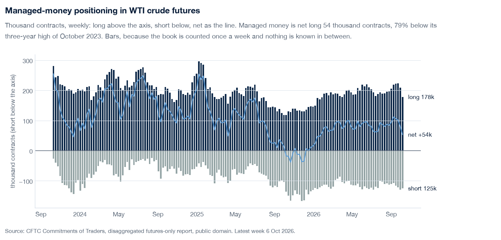

# Supply or demand

Public data on oil, gas, power and the wider economy, pulled from the original sources into a local store, checked, and served to a dashboard and a read-only API.

Energy analysis stands or falls on the numbers behind it, so this project collects the public ones: the EIA's weekly oil statistics, European gas storage from the storage operators, European grid and gas flows, trader positioning from the CFTC, OPEC and JODI balances, rig counts, exchange rates, weather and more. About 1,600 time series from around twenty sources land in a lake of Parquet files read with DuckDB. A publish step copies a serving set to Postgres, and two websites and a Streamlit app read from there. It runs on one laptop and a free Postgres tier.

It is careful about a few things most dashboards are not. Seasonal comparisons always leave out 2020, in one shared module rather than re-implemented per page. A series' date is the data's own date, never the time the job ran, and a source that stopped updating keeps its old date. Gaps are never bridged: a missing week stays missing rather than being drawn through. Colour never carries meaning alone; a direction always shows a sign as well. And failures are loud: a partial run exits with an error rather than reporting success, and credentials are stripped from error text before it is printed.

## Charts

Drawn from the lake with `uv run python -m apps.exhibits.readme_charts`.




Crude moved between US regions is kept apart by mode because the mode is usually the story: Bakken crude moved by rail because there was no pipe, and stopped when there was.


The dashboard itself, as served:


## How it works

One pipeline per source downloads the data and keeps the raw response. Every value is then written into one of a few shared shapes, validated on write: `ts_long` for a time series, `flows` for movement between two places, `events`, and `vessel_positions`. The lake is partitioned Parquet with revision-aware de-duplication, so a corrected number is a new row. A publish step copies the serving set to Postgres with row-level security and a provenance log of which pipeline wrote what, when, and with what as-of date. The Next.js data site, the landing page and the Streamlit explorer read that copy, and the pipelines tell the sites when to refresh. Pipelines never draw and the sites never call a source API, which is what makes a chart reproducible offline.

## Getting started

```bash
git clone https://github.com/rikokardamow/supply-or-demand.git
cd supply-or-demand
uv sync --all-extras
cp .env.example .env                              # API keys; git-ignored

uv run python -m pipelines.eia.pull_wpsr          # fill the lake with one source
uv run streamlit run apps/dashboard/app.py        # explore it
```

Most sources need a free key. The dashboard runs with whatever subset you have; a page with no data shows an empty state instead of failing.

The web app needs a Postgres serving layer. Any Postgres works, though the migrations in `supabase/migrations/` assume Supabase for row-level security and PostgREST.

```bash
cd web && cp .env.example .env.local && pnpm install && pnpm dev
uv run python -m pipelines.derived.publish_series  # publish the lake into it
```

The landing page is a second Next.js app in `site/`, run the same way on port 3100. Everything runs locally; hosting is optional.

## The read API

The serving layer is a public, read-only REST API through PostgREST. Every table grants `SELECT` to the anonymous role under row-level security and there is no write path, which is why the anonymous key can sit in the browser bundle.

```bash
curl "$SUPABASE_URL/rest/v1/series_long?series_id=eq.fut.cl.f01.close&order=ts.desc&limit=5" \
  -H "apikey: $SUPABASE_ANON_KEY" -H "Accept-Profile: serving"
```

`series_long` holds every scalar series (prices, stocks, storage, positioning, macro); `seasonal` the day-of-year range, median and current track with 2020 excluded; `flows` movement between two places (inter-PADD crude, grid interchange, gas); `wpsr_lines` the weekly petroleum report's summary table as published; `curve_settles` and `spreads` the futures curves and calendar spreads; `events` and `sanctions` tagged news and the OFAC list; `vessel_latest` the latest AIS position per vessel; and `publish_log` the provenance. Two things to know: `as_of` is the data's own date, and PostgREST returns at most 1,000 rows per request, so page with `offset` (`web/src/data/paginate.ts` shows how).

## Layout

`pipelines/` has one folder per source, each with its client, its notes on what was verified live against that API, and a test recorded against the real response. `core/` holds the shared pieces: schemas, seasonal maths, publishing, failure handling, settings and the chart theme. `apps/dashboard/` is the Streamlit explorer, `apps/artifacts/` the published exhibit pages and Office exports, `apps/exhibits/` the README charts. `web/` and `site/` are the two Next.js apps, `supabase/migrations/` the serving schema, `infra/` scheduling and deployment, `specs/` the build specifications one per feature, and `tests/` the test suite, including a check that fails the build if a recorded response contains a key. `data/` is the lake and the raw downloads and is not in git.

`DEVELOPMENT.md` holds the conventions, commands and credential rules; `CHANGELOG.md` is the full build log; `docs/README.md` explains the specification numbering and the rest of the documents.

## Contributing

Run `make check` (ruff, mypy, pytest) and the web tests (`pnpm typecheck && pnpm lint && pnpm test` in `web/` and `site/`) before opening a pull request. To add a source, scaffold `pipelines/<source>/` with its own `NOTES.md`, a client and a test recorded against the real API; never guess a schema. Add the source's terms to the table below. British English in prose, labels and docstrings.

## Licence and data terms

The code is MIT, © 2026 Riko Kardamow. The data is not the project's to relicense: each source keeps its own terms, and several restrict use. Check the table before deploying anywhere, especially commercially.

| Source | Terms | Notes |
|---|---|---|
| EIA, FRED, Frankfurter, Eurostat, GIE AGSI+/ALSI+, ENTSO-E, ENTSOG, EirGrid, OPEC, JODI, Baker Hughes, gridstatus, OFAC | Free public or government data, or a free API key; no attribution requirement found in each provider's own documents | Checked per pipeline during its build; see each `pipelines/<source>/NOTES.md` |
| Open-Meteo | Free for non-commercial use only | A personal research tool, not a commercial product; revisit if that changes |
| ECMWF Open Data | Free, CC BY 4.0, attribution required | Carried as a caption under each weather map |
| NOAA GFS | US government data, public domain | Attribution carried anyway |
| GDELT | Free; the project asks to be credited | Not yet carried on the page; a known gap |
| The Guardian Open Platform | Free registered tier, attribution required | Key not yet set; revisit once live |
| NewsAPI | Free tier is for development only, no scheduled use | Kept to a manual, on-demand search |
