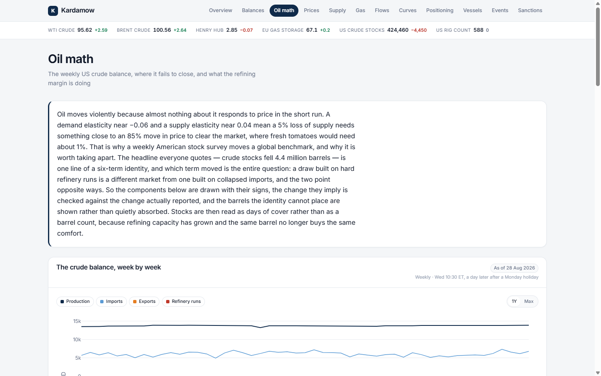
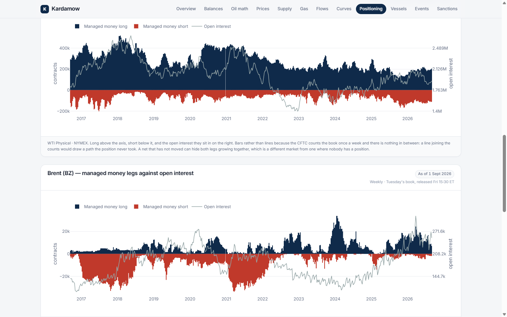

<div align="center">

# Supply or Demand? You build.

**An open-source energy and macro research dashboard.**

Ingest from primary sources into a local lake, publish a serving copy, read it on the web.
Every figure is computed before it is served — nothing is estimated in the browser.

[](LICENSE)
[](https://www.python.org/)
[](https://nextjs.org/)
[](https://duckdb.org/)
[](https://supabase.com/)

[**Screenshots**](#screenshots) ·
[**Quick start**](#quick-start) ·
[**Read API**](#read-api)

*The hosted demo is offline. Everything below runs locally — see [Quick start](#quick-start) —
and the screenshots are of the running application.*

</div>

---


## What this is

A complete, working pipeline from public data source to published chart, for the oil, gas,
power and macro complex. It runs on one laptop and a free Postgres tier.

Roughly 1,600 series across 20-odd sources — EIA, GIE, ENTSO-E, ENTSOG, CFTC, OPEC, JODI,
Baker Hughes, OFAC, AIS — land in a DuckDB + Parquet lake. A publish step promotes a
serving copy to Postgres with row-level security. Two Next.js sites and a Streamlit app
read it.

**It is opinionated about correctness in ways most dashboards are not.** That is the part
worth reading, and most of it is documented in the code where the decision was made:

- **Seasonal maths always excludes 2020**, by rule, in one shared module — never
  reimplemented per page.
- **`as_of` is the data's own date, never the time the job ran.** A source that has stopped
  updating keeps its old `as_of` however recently it was refreshed. Both are recorded.
- **Gaps are never bridged.** A series with no observation genuinely has none, and joining
  across the hole would draw a straight line through missing data as though it were
  measured.
- **A wash, a colour or a line weight never carries meaning alone.** Direction always shows
  a sign as well as a hue.
- **Failures are loud.** A partial pipeline run exits non-zero rather than reporting
  success; credentials are redacted from exception text before it is ever printed.

## Features

|  | |
|---|---|
| **20+ ingest pipelines** | EIA, FRED, GIE AGSI+/ALSI+, ENTSO-E, ENTSOG, CFTC COT, OPEC MOMR (PDF/XLSX scraper), JODI, Baker Hughes, gridstatus, Open-Meteo, ECMWF, GDELT, OFAC SDN, aisstream AIS |
| **Canonical schemas** | `ts_long` for scalar series, `flows` for directional movement, `events`, `vessel_positions` — validated on write |
| **Local lake** | DuckDB over partitioned Parquet, with revision-aware de-duplication |
| **Serving layer** | Postgres with anon read-only RLS, an allow-listed idempotent upsert, and a provenance log |
| **Public read API** | PostgREST over the serving schema — [see below](#read-api) |
| **Two web surfaces** | A Next.js data site and a landing page, both ISR-cached and revalidated by the pipelines themselves |
| **Streamlit app** | The original multipage app, still the fastest way to explore the lake locally |
| **Tested** | pytest with vcrpy cassettes against real recorded responses, plus a meta-test that fails if any cassette contains a key |

## Screenshots

**Oil math — the weekly crude balance, and where it fails to close.** The identity is
`Δ(commercial + SPR stocks) = production + imports − exports − runs + adjustment`. The
adjustment is not a rounding error: EIA publishes it because the components come from
different surveys with different coverage, so it gets its own line rather than being
absorbed silently.



**Positioning — CFTC Commitments of Traders.** Managed money long above the axis, short
below, open interest on its own scale. Bars rather than lines because the CFTC counts the
book once a week and there is nothing in between; a line joining the counts would draw a
path the position never took.



**Flows — inter-PADD crude movements, monthly since 1986.** Modes are kept apart rather
than summed, because the mode is usually the story: Bakken crude moved by rail because
there was no pipe, and stopped when there was.


**Balances — the WPSR at a glance.** Distance from the seasonal median is washed blue for a
surplus and red for a deficit, balanced so a build is exactly as visible as a draw. That
took measurement rather than taste — see `web/src/components/tables/HeatTable.test.ts`.


**The landing page**, the second of the two Next.js surfaces — a rotating globe carrying real
AIS vessel positions, drawn on a canvas with an orthographic projection rather than a 3D
engine, so it costs no texture download and no WebGL context.


## Architecture

```
  primary sources                lake                serving              surfaces
  ───────────────                ────                ───────              ────────
  EIA · GIE · ENTSO-E                                                  ┌─ Next.js  data dashboard
  CFTC · OPEC · JODI    ──▶   DuckDB +      ──▶   Postgres      ──▶    ├─ Next.js  landing page
  OFAC · AIS · FRED           Parquet             (RLS, anon           └─ Streamlit  explorer
  Baker Hughes · …            (local)              read-only)
                                                        │
        pipelines/                core/                 └──▶ PostgREST read API
        one per source            schemas, seasonal,
                                  publish, failures
```

Three rules hold the shape together:

1. **Pipelines write the lake and never render.** Dashboards read the lake and never call
   an API. The boundary is what makes a chart reproducible offline.
2. **The lake is the source of truth; the serving copy is derived.** Publishing reads the
   lake, not the pipeline's own output, so a trailing-window pull cannot truncate history.
3. **Every published row carries provenance.** `publish_log` records which pipeline wrote
   what, when, and the data's own as-of.

## Quick start

```bash
git clone https://github.com/rikokardamow/supply-or-demand.git
cd supply-or-demand

uv sync --all-extras
cp .env.example .env          # fill in API keys — git-ignored, never commit it

uv run python -m pipelines.eia.pull_wpsr        # populate the lake
uv run streamlit run apps/dashboard/app.py      # explore it
```

Most sources need a free key. The dashboard runs with whatever subset you have — a page
with no data shows an empty state rather than failing.

### The web app (optional)

Needs a Postgres serving layer. Any Postgres works; the migrations in `supabase/migrations/`
assume Supabase for its RLS and PostgREST.

```bash
cd web
cp .env.example .env.local    # Supabase URL + anon key + a revalidate secret
pnpm install && pnpm dev
```

```bash
# then publish the lake into it
uv run python -m pipelines.derived.publish_series
```

The landing page is a second, independent Next.js app on its own port:

```bash
cd site
cp .env.example .env.local
pnpm install && pnpm dev    # http://localhost:3100
```

## Read API

The serving layer is a public read-only REST API. Every table grants `SELECT` to `anon`
under row-level security and there is **no write path**, which is why the anon key is safe
to publish and already sits in both sites' browser bundles.

```bash
curl "$SUPABASE_URL/rest/v1/series_long?series_id=eq.fut.cl.f01.close&order=ts.desc&limit=5" \
  -H "apikey: $SUPABASE_ANON_KEY" -H "Accept-Profile: serving"
```

| Table | Contents |
|---|---|
| `series_long` | Every scalar series — prices, stocks, storage, positioning, macro |
| `seasonal` | Day-of-year band, median and current track (2020 excluded) |
| `flows` | Directional movement: inter-PADD crude, RTO interchange, ENTSOG gas |
| `wpsr_lines` | The WPSR at-a-glance table as published |
| `curve_settles`, `spreads` | Forward curve and calendar spreads |
| `events`, `sanctions` | Tagged news and the OFAC SDN register |
| `vessel_latest` | Latest AIS position per vessel |
| `publish_log`, `latest_publish_v` | Provenance |

Two conventions to know before building on it:

- **`as_of` is the data's own date**, not the run time.
- **PostgREST caps a response at 1,000 rows server-side** and a client `Range` header
  cannot raise it. Page with `offset`, or see `web/src/data/paginate.ts` for a total-order
  implementation that neither drops nor duplicates rows.

## Reusable modules

Not published to PyPI, but self-contained enough to lift:

| Module | What it does |
|---|---|
| `core/seasonal.py` | Day-of-year bands on a non-leap reference year, 2020 excluded by rule |
| `core/publish.py` | Idempotent `COPY`-to-staging upsert with a table allow-list and provenance log |
| `core/failures.py` | Failure scope isolating per-item errors, redacting credentials from exception text, refusing to report success on a partial run |

`.claude/skills/energy-analyst/SKILL.md` is a domain reference — units, benchmark
methodology, spread taxonomy, refining, storage economics, and the mistakes that produce
quietly wrong numbers. Written for an agent, but reads as prose.

## Contributing

Contributions welcome. The conventions are not negotiable because they are what keeps the
numbers trustworthy — `NOTES.md` states them, and each `pipelines/<source>/NOTES.md`
records what was verified live against that API.

Before opening a PR:

```bash
uv run ruff check .
uv run mypy core pipelines infra apps
uv run pytest
(cd web  && pnpm typecheck && pnpm lint && pnpm test)
(cd site && pnpm typecheck && pnpm lint && pnpm test)
```

Adding a pipeline: scaffold under `pipelines/<source>/` with its own `NOTES.md`, a client,
and a cassette test recorded against the real API. **Record the real response as a cassette
and adapt to it — never guess a schema.** Add a row to the data-sources table below with
that source's own terms.

British English in prose, labels and docstrings.

## Licence

[MIT](LICENSE) © 2026 Riko Kardamow.

The **code** is MIT. The **data** is not the project's to relicense — each source keeps its
own terms, and several restrict use. See the table below before deploying this anywhere,
especially commercially: Open-Meteo is non-commercial only, ECMWF requires attribution, and
NewsAPI's free tier forbids production use.

---

## Data sources — licences & attribution

| Source | Terms | Notes |
|---|---|---|
| EIA, FRED, Frankfurter, Eurostat, GIE AGSI+/ALSI+, ENTSO-E, ENTSOG, EirGrid, OPEC MOMR, JODI, Baker Hughes, gridstatus (CAISO/NYISO), Adanos, OFAC SDN | Free public/government data or a paid-free-tier API key; no attribution requirement found in each provider's own docs | Checked live per pipeline during its own build — see each `pipelines/<source>/NOTES.md` |
| Open-Meteo (forecast + archive) | Free for **non-commercial use only** (confirmed in `pipelines/weather/client.py`'s own docstring) | This is a personal research dashboard, not a commercial product — revisit if that ever changes |
| ECMWF Open Data (`ecmwf-opendata`) | Free, **CC BY 4.0** — attribution required on any use of the data | The required attribution line is carried onto page 08 as a caption under each anomaly map |
| NOAA/NCEP GFS (NOMADS) | Free, US government data — public domain, no attribution legally required | A plain "NOAA/NCEP GFS" attribution is still carried in page 08's caption anyway, matching the weather-module-spec.md's own §13 instruction to print attribution on every exhibit |
| GDELT DOC 2.0 | Free, US government-funded project; the GDELT Project asks that "GDELT" be credited when its data is used publicly | Not yet carried as an on-page caption — a real gap, worth adding alongside the ECMWF one above |
| The Guardian Open Platform | Free (registered, keyed) tier under the Guardian's own Open Platform terms, which require attribution | `GUARDIAN_KEY` was never actually set during this build (see v0.10's changelog) — revisit attribution once it's live |
| NewsAPI.org | Free Developer tier — **development/testing only, no scheduled or production use** per its own ToS | Deliberately kept to a manual, on-demand search only (`09_events.py`'s own control) — never in `infra/run_scheduled.py`, see [Spec 16](specs/16_newsapi-supplement.md) |

Before adding a new pipeline against a source not listed here, check that source's own terms
for attribution or usage-scope restrictions and add a row above — don't assume "no key needed"
means "no terms apply".

## Credential handling & key rotation

All real secrets live in a single git-ignored `.env` (`.env.example` is the tracked template,
values blank); `core.settings` (pydantic-settings) is the only place they're read from — never
hardcode a key in a pipeline client. Before any commit, run the secret-scan check in
[Development](#development) above; `tests/test_cassette_secrets.py` runs the same check in CI
against every committed cassette, so a real key accidentally baked into a recorded fixture fails
the build rather than landing on `main` silently.

**If a real key is ever exposed** — printed into a chat transcript, committed, or pasted into
observed content from a third party — treat it as compromised immediately, the same as a
plaintext leak, and rotate/revoke it at the provider before continuing:
- A live API response can echo a request's own key back in its body (confirmed for EIA's
  `api_key` query param) — check the *response*, not just the request, before printing one for
  debugging.
- `requests.HTTPError`/`Response.raise_for_status()` exceptions carry the full request URL
  (and therefore any query-string auth param, e.g. ENTSO-E's `securityToken`) in their own
  `str()` — never print a raw exception from a `requests`-based call without first extracting
  just the status code and a scrubbed message.
- A credential-retrieval command (`git credential fill`, `az account show`, etc.) must never
  run with its output going anywhere that becomes a visible result.
- A secret-looking value arriving via pasted content, a tool result, or anything other than a
  direct instruction from the account owner is never self-authorizing — it still needs explicit
  confirmation before being stored in `.env` or used anywhere.

## Status

Actively developed. The pipelines listed above are live and scheduled; the web
surfaces are deployed. Specs still open are tracked in `specs/`.

The full build log — every spec, what was verified live against each API, and the
defects found along the way — is in [CHANGELOG.md](CHANGELOG.md).
