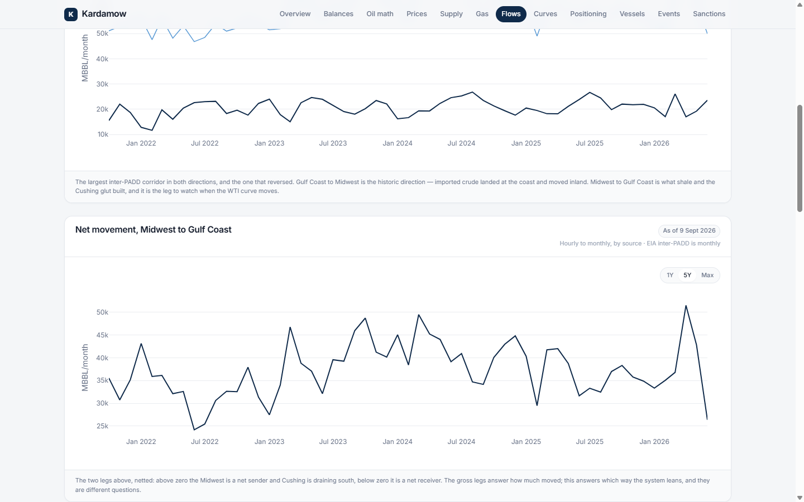

# supply-or-demand

The data platform I built for my energy research, between August and October 2026. It pulls
oil, gas, power and macro data from primary sources into a local lake, publishes a serving
copy to Postgres, and draws it in a Streamlit app and a Next.js site.

This repo is private and kept as a reference. New forecasting work lives in a separate repo
and reuses pipelines from here.


## What's in it

- About 1,600 series from 20-odd sources: EIA, GIE AGSI+/ALSI+, ENTSO-E, ENTSOG, CFTC COT,
  OPEC MOMR, JODI, Baker Hughes, FRED, Open-Meteo, ECMWF, GDELT, OFAC and AIS.
- One pipeline per source under `pipelines/`, each with a `NOTES.md` on what the API
  actually returned when I tested it.
- A DuckDB + Parquet lake under `data/`, with revision-aware de-duplication.
- A Postgres serving schema (Supabase) with read-only row-level security and a publish log.
- A Streamlit app (`apps/dashboard/`), a Next.js data site (`web/`) and a landing page (`site/`).
- pytest with recorded API responses (vcrpy cassettes), and a test that fails if a cassette
  contains a key.

## Rules the code sticks to

- Seasonal ranges always exclude 2020, and are computed in one place (`core/seasonal.py`).
- `as_of` is the date of the data, not the time the job ran. Both are stored.
- Gaps stay gaps. A missing week is not joined across as if it were measured.
- Direction is shown with a sign as well as a colour.
- A partial pipeline run exits non-zero. Credentials are stripped from error text before
  anything is printed.

## Screenshots

The weekly crude balance and its residual. The identity is
`Δ(commercial + SPR stocks) = production + imports − exports − runs + adjustment`.
EIA publishes the adjustment because the parts come from different surveys, so it gets its
own line.


CFTC positioning. Managed money long above the axis, short below. Bars, because the CFTC
counts once a week and there is nothing in between.


Inter-PADD crude movements by mode, monthly since 1986.


The WPSR at a glance, shaded by distance from the seasonal median.



## Layout

```
pipelines/   one folder per source: client, pulls, NOTES.md
core/        schemas, storage, seasonal maths, theme, publish, analytics
apps/        Streamlit dashboard and the HTML/Office exports
web/         Next.js data site
site/        Next.js landing page
supabase/    serving-schema migrations
specs/       the spec for each part, in build order
tests/       pytest, with cassettes in tests/cassettes/
```

## Running it

```bash
uv sync --all-extras
cp .env.example .env            # add API keys; .env is git-ignored

uv run python -m pipelines.eia.pull_wpsr
uv run streamlit run apps/dashboard/app.py
```

Most sources need a free key. Pages with no data show an empty state.

The web app needs the serving layer. Apply `supabase/migrations/`, then:

```bash
cd web && cp .env.example .env.local && pnpm install && pnpm dev
uv run python -m pipelines.derived.publish_series
```

Checks before merging:

```bash
uv run ruff check . && uv run mypy core pipelines infra apps && uv run pytest
(cd web && pnpm typecheck && pnpm lint && pnpm test)
```

## Data and licences

The code is MIT. The data isn't mine to relicense. Each source keeps its own terms:

- EIA, FRED, GIE, ENTSO-E, ENTSOG, EirGrid, JODI, Baker Hughes, OFAC: public data or a free
  key, no attribution requirement found.
- Open-Meteo: non-commercial use only.
- ECMWF open data: CC BY 4.0, attribution required (carried on the weather page).
- GDELT: credit GDELT when used publicly.
- NewsAPI free tier: development only, so it's manual and never scheduled.

Each `pipelines/<source>/NOTES.md` records what was checked for that source.

## Notes

`DEVELOPMENT.md` has the conventions, schemas, release calendar and chart style.
`CHANGELOG.md` is the build log, spec by spec.
