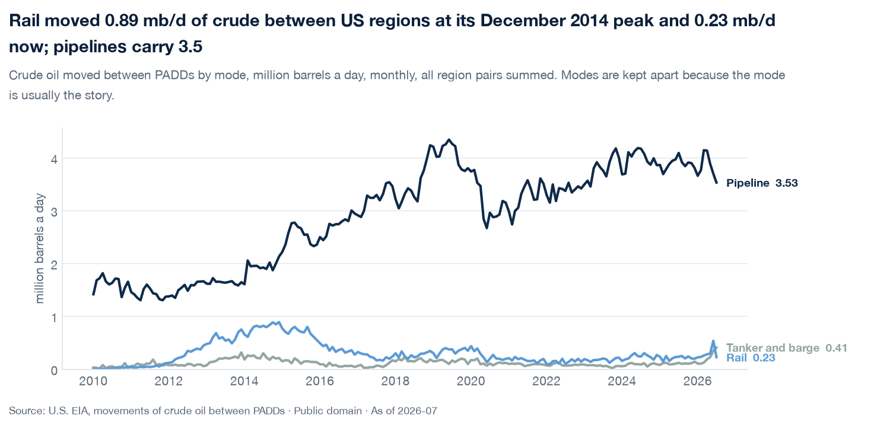
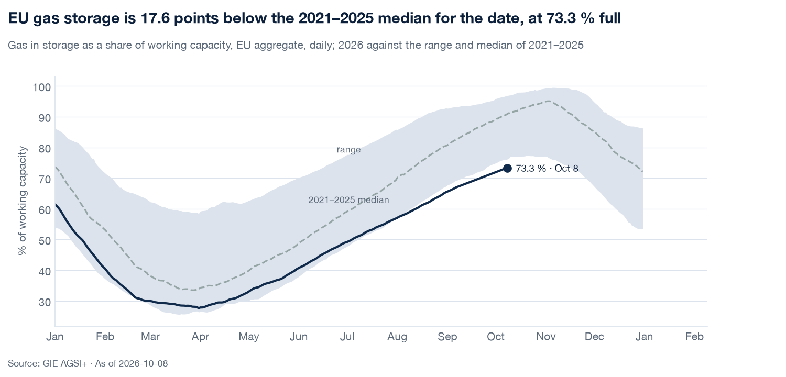
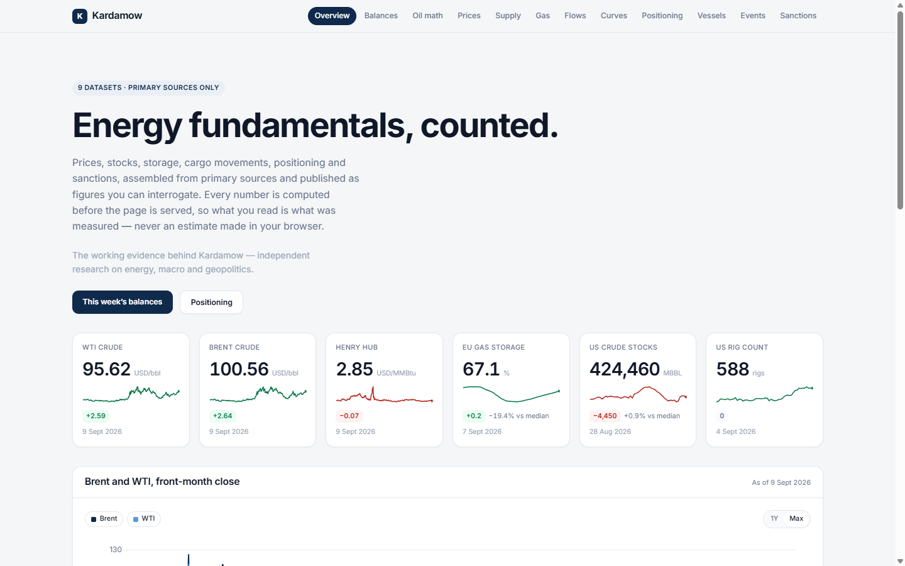

# Supply or demand

An open energy-data pipeline: public data on oil, gas, power and the wider economy, pulled from the original sources into a local store, checked, and served to a dashboard and a read-only API.

## What this is

Energy analysis stands or falls on the numbers behind it. This project collects the public ones: US weekly oil statistics from the EIA, European gas storage from the storage operators, European grid and gas flows, trader positioning from the CFTC, OPEC and JODI balances, rig counts, exchange rates, weather and more. About 1,600 time series from around twenty sources land in a local lake of Parquet files read with DuckDB. A publish step copies a serving set to Postgres, and two websites and a Streamlit app read from there.

It is careful about things most dashboards are not:

- **Seasonal comparisons always leave out 2020**, in one shared module, never re-implemented per page.
- **A series' date is the data's own date, never the time the job ran.** A source that stopped updating keeps its old date, and both are recorded.
- **Gaps are never bridged.** A missing week stays missing rather than being drawn through.
- **Colour never carries meaning alone.** A direction always shows a sign as well.
- **Failures are loud.** A partial run exits with an error rather than reporting success, and credentials are redacted from error text before it is printed.

It runs on one laptop and a free Postgres tier.

## How it works

1. **Pull.** One pipeline per source downloads the data and keeps the raw response.
2. **Shape.** Every value is written into one of a few shared shapes: `ts_long` for a time series, `flows` for movement between two places, `events`, `vessel_positions`. The shapes are validated on write.
3. **Store.** The lake is partitioned Parquet with revision-aware de-duplication, so a corrected number is a new row.
4. **Publish.** A serving copy goes to Postgres with row-level security and a provenance log of which pipeline wrote what, when, and with what as-of date.
5. **Serve.** A Next.js data site, a landing page and a Streamlit explorer read the serving copy; the pipelines tell the sites when to refresh.

## Charts

Drawn from the lake with `uv run python -m apps.exhibits.readme_charts`.

**Stocks against their season.** US commercial crude stocks against the range of the same date in recent years.


**Positioning.** Managed-money long and short positions in WTI, as weekly bars because the book is counted once a week and nothing is known in between.


**Flows.** Crude moved between US regions, kept apart by mode: Bakken crude moved by rail because there was no pipe, and stopped when there was.



**European gas storage.** The EU's storage fill against the range of recent years.



The dashboard itself, as served:



## Quick start

```bash
git clone https://github.com/rikokardamow/supply-or-demand.git
cd supply-or-demand
uv sync --all-extras
cp .env.example .env                              # API keys; git-ignored

uv run python -m pipelines.eia.pull_wpsr          # fill the lake with one source
uv run streamlit run apps/dashboard/app.py        # explore it
```

Most sources need a free key. The dashboard runs with whatever subset you have; a page with no data shows an empty state instead of failing.

The web app needs a Postgres serving layer (any Postgres works; the migrations in `supabase/migrations/` assume Supabase for row-level security and PostgREST):

```bash
cd web && cp .env.example .env.local && pnpm install && pnpm dev
uv run python -m pipelines.derived.publish_series  # publish the lake into it
```

The landing page is a second Next.js app in `site/`, run the same way on port 3100. Hosting is optional; everything runs locally.

## Read API

The serving layer is a public, read-only REST API (PostgREST). Every table grants `SELECT` to the anonymous role under row-level security and there is no write path, which is why the anonymous key can sit in the browser bundle.

```bash
curl "$SUPABASE_URL/rest/v1/series_long?series_id=eq.fut.cl.f01.close&order=ts.desc&limit=5" \
  -H "apikey: $SUPABASE_ANON_KEY" -H "Accept-Profile: serving"
```

| Table | Contents |
|---|---|
| `series_long` | Every scalar series: prices, stocks, storage, positioning, macro |
| `seasonal` | Day-of-year range, median and current track, 2020 excluded |
| `flows` | Movement between two places: inter-PADD crude, grid interchange, gas |
| `wpsr_lines` | The weekly petroleum report's summary table as published |
| `curve_settles`, `spreads` | Futures curves and calendar spreads |
| `events`, `sanctions` | Tagged news and the OFAC sanctions list |
| `vessel_latest` | Latest AIS position per vessel |
| `publish_log`, `latest_publish_v` | Provenance |

Two conventions: `as_of` is the data's own date, and PostgREST returns at most 1,000 rows per request, so page with `offset` (see `web/src/data/paginate.ts`).

## Layout

| Path | What it holds |
|---|---|
| `pipelines/` | One folder per source, each with its client, its notes and a recorded test |
| `core/` | The shared pieces: schemas, seasonal maths, publishing, failure handling, settings, chart theme |
| `apps/dashboard/` | The Streamlit explorer |
| `apps/artifacts/` | Published exhibit pages and Office exports |
| `apps/exhibits/` | The README charts |
| `web/`, `site/` | The Next.js data site and landing page |
| `supabase/migrations/` | The serving schema |
| `infra/` | Scheduling and deployment |
| `specs/` | The build specifications, one per feature |
| `tests/` | pytest with recorded API responses; a check fails the build if a recording contains a key |
| `data/` | The lake and raw downloads (not in git) |

## Documents

Start with `docs/README.md`, the reading guide. `DEVELOPMENT.md` holds the conventions, commands and credential rules; `CHANGELOG.md` the full build log; `specs/` the specifications.

## Contributing

Before opening a pull request, run `make check` (ruff, mypy, pytest) and the web tests (`pnpm typecheck && pnpm lint && pnpm test` in `web/` and `site/`). To add a source, scaffold `pipelines/<source>/` with its own `NOTES.md`, a client and a test recorded against the real API; never guess a schema. Add the source's terms to the table below. British English in prose, labels and docstrings.

## Licence and data terms

The code is MIT, © 2026 Riko Kardamow. The data is not the project's to relicense: each source keeps its own terms, and several restrict use. Check the table before deploying anywhere, especially commercially.

| Source | Terms | Notes |
|---|---|---|
| EIA, FRED, Frankfurter, Eurostat, GIE AGSI+/ALSI+, ENTSO-E, ENTSOG, EirGrid, OPEC, JODI, Baker Hughes, gridstatus, OFAC | Free public or government data, or a free API key; no attribution requirement found in each provider's own documents | Checked per pipeline during its build; see each `pipelines/<source>/NOTES.md` |
| Open-Meteo | Free for non-commercial use only | A personal research tool, not a commercial product; revisit if that changes |
| ECMWF Open Data | Free, CC BY 4.0, attribution required | Carried as a caption under each weather map |
| NOAA GFS | US government data, public domain | Attribution carried anyway |
| GDELT | Free; the project asks to be credited | Not yet carried on the page; a known gap |
| The Guardian Open Platform | Free registered tier, attribution required | Key not yet set; revisit once live |
| NewsAPI | Free tier is for development only, no scheduled use | Kept to a manual, on-demand search |

## Glossary

- **Lake**: the local store of Parquet files, one folder per shape and source, read with DuckDB.
- **Serving layer**: the Postgres copy the websites read. Derived from the lake, never the other way round.
- **Row-level security**: Postgres rules that decide which rows a role may read; here the anonymous role may read everything and write nothing.
- **PostgREST**: the service that turns a Postgres schema into a REST API.
- **As-of date**: the date the data describes, as distinct from when it was fetched.
- **Revision**: a later publication of the same number. The lake keeps every revision.
- **Seasonal band**: the range and median of the same day of year over a set of past years, with 2020 excluded.
- **WPSR**: the EIA's Weekly Petroleum Status Report, published on Wednesdays.
- **PADD**: the five Petroleum Administration for Defense Districts the EIA uses to split the US.
- **COT**: the CFTC's weekly Commitments of Traders report on futures positioning.
- **Managed money**: hedge funds and other asset managers in the COT report.
- **Cassette**: a recorded API response used by a test, so tests run offline against real data.
