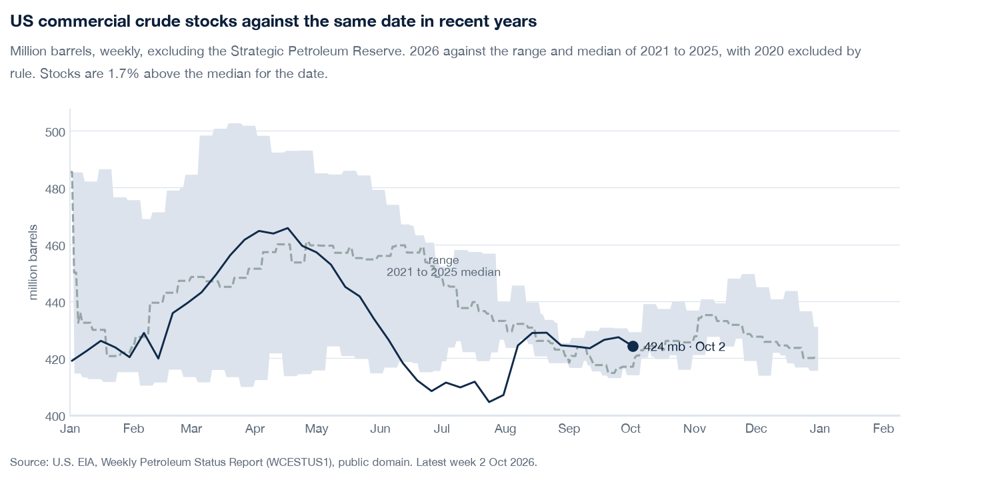

# Supply or demand

Public data on oil, gas, power and the wider economy, pulled from the original sources into a local store, checked, and served to a dashboard and a read-only API.

Energy analysis stands or falls on the numbers behind it, so this project collects the public ones: the EIA's weekly oil statistics, European gas storage from the storage operators, European grid and gas flows, trader positioning from the CFTC, OPEC and JODI balances, rig counts, exchange rates, weather and more. About 1,600 time series from around twenty sources land in a lake of Parquet files read with DuckDB. A publish step copies a serving set to Postgres, and two websites and a Streamlit app read from there. It runs on one laptop and a free Postgres tier.

It is careful about a few things most dashboards are not. Seasonal comparisons always leave out 2020, in one shared module rather than re-implemented per page. A series' date is the data's own date, never the time the job ran, and a source that stopped updating keeps its old date. Gaps are never bridged: a missing week stays missing rather than being drawn through. Colour never carries meaning alone; a direction always shows a sign as well. And failures are loud: a partial run exits with an error rather than reporting success, and credentials are stripped from error text before it is printed.

## Charts

Drawn from the lake with `uv run python -m apps.exhibits.readme_charts`.

Each chart is also written beside its PNG as a vector PDF and a LaTeX caption (`docs/img/*.pdf`, `docs/img/*.tex`), in the paper format described in [`docs/FIGURES.md`](docs/FIGURES.md): the finding, units, source and as-of date are in the caption, not on the image, and the line under each chart repeats its finding and source. The data keeps each source's own terms.



*Figure: US commercial crude stocks are 1.7% above the median for the date. Source: U.S. EIA, Weekly Petroleum Status Report (series WCESTUS1); Public domain; as of 2026-10-02.*


*Figure: Managed money is net long 54 thousand contracts, 79% below its three-year high of October 2023. Source: CFTC Commitments of Traders, disaggregated futures-only report (series cftc.cl.mm_long, cftc.cl.mm_short); Public domain; as of 2026-10-06.*

Crude moved between US regions is kept apart by mode because the mode is usually the story: Bakken crude moved by rail because there was no pipe, and stopped when there was.


*Figure: Rail peaked at 0.89 mb/d in December 2014 and carries 0.23 now; pipelines carry 3.5. Source: U.S. EIA, movements of crude oil between PADDs (latest month July 2026); Public domain; as of 2026-07-31.*


*Figure: EU gas storage is 73.3% full, 17.6 points below the median for the date. Source: GIE AGSI+ (series agsi.EU.full_pct); as of 2026-10-08.*

## How it works

One pipeline per source downloads the data and keeps the raw response. Every value is then written into one of a few shared shapes, validated on write: `ts_long` for a time series, `flows` for movement between two places, `events`, and `vessel_positions`. The lake is partitioned Parquet de-duplicated on series and date: a corrected number replaces the earlier one, and the write time is kept in `revision_date`. First prints are not retained yet (see `PARKING.md`). A publish step copies the serving set to Postgres with row-level security and a provenance log of which pipeline wrote what, when, and with what as-of date. The Next.js data site, the landing page and the Streamlit explorer read that copy, and the pipelines tell the sites when to refresh. Pipelines never draw and the sites never call a source API, which is what makes a chart reproducible offline.

## Getting started

```bash
git clone https://github.com/rikokardamow/supply-or-demand.git
cd supply-or-demand
uv sync --all-extras
cp .env.example .env                              # API keys; git-ignored

uv run python -m pipelines.eia.pull_wpsr          # fill the lake with one source
uv run streamlit run apps/dashboard/app.py        # explore it
```

Most sources need a free key. The dashboard runs with whatever subset you have; a page with no data shows an empty state instead of failing.

The web app needs a Postgres serving layer. Any Postgres works, though the migrations in `supabase/migrations/` assume Supabase for row-level security and PostgREST.

```bash
cd web && cp .env.example .env.local && pnpm install && pnpm dev
uv run python -m pipelines.derived.publish_series  # publish the lake into it
```

The landing page is a second Next.js app in `site/`, run the same way on port 3100. Everything runs locally; hosting is optional.

## The read API

The serving layer is a public, read-only REST API through PostgREST. Every table grants `SELECT` to the anonymous role under row-level security and there is no write path, which is why the anonymous key can sit in the browser bundle.

```bash
curl "$SUPABASE_URL/rest/v1/series_long?series_id=eq.WCESTUS1&order=ts.desc&limit=5" \
  -H "apikey: $SUPABASE_ANON_KEY" -H "Accept-Profile: serving"
```

`series_long` holds the scalar series the rights register lets through (stocks, storage, positioning, macro; see `RIGHTS.md`); `seasonal` the day-of-year range, median and current track with 2020 excluded; `flows` movement between two places (inter-PADD crude, grid interchange, gas); `wpsr_lines` the weekly petroleum report's summary table as published; `spreads` the calendar spreads from EIA's NYMEX ranks (`curve_settles`, a Brent curve rebuilt from a vendor export, is class d and not published); `events` and `sanctions` tagged news and the OFAC list; `vessel_latest` the latest AIS position per vessel; and `publish_log` the provenance. Two things to know: `as_of` is the data's own date, and PostgREST returns at most 1,000 rows per request, so page with `offset` (`web/src/data/paginate.ts` shows how).

## Layout

`pipelines/` has one folder per source, each with its client, its notes on what was verified live against that API, and a test recorded against the real response. `core/` holds the shared pieces: schemas, seasonal maths, publishing, failure handling, settings and the chart theme. `apps/dashboard/` is the Streamlit explorer, `apps/artifacts/` the published exhibit pages and Office exports, `apps/exhibits/` the README charts. `web/` and `site/` are the two Next.js apps, `supabase/migrations/` the serving schema, `infra/` scheduling and deployment, `core/rights.py` and `RIGHTS.md` each source's terms and class, `specs/` the build specifications one per feature, and `tests/` the test suite, including a check that fails the build if a recorded response contains a key. `data/` is the lake and the raw downloads and is not in git.

`DEVELOPMENT.md` holds the conventions, commands and credential rules; `CHANGELOG.md` is the full build log; `docs/README.md` explains the specification numbering and the rest of the documents.

## Contributing

Run `make check` (ruff, mypy, pytest) and the web tests (`pnpm typecheck && pnpm lint && pnpm test` in `web/` and `site/`) before opening a pull request. To add a source, scaffold `pipelines/<source>/` with its own `NOTES.md`, a client and a test recorded against the real API; never guess a schema. Read the source's terms at source and add it to `core/rights.py` with its class; `uv run python -m core.rights` rewrites `RIGHTS.md`, and the publish step refuses a source that is not registered. British English in prose, labels and docstrings.

## Licence and data terms

The code is MIT, © 2026 Riko Kardamow. The data is not the project's to relicense: each source keeps its own terms, and several restrict use. [`RIGHTS.md`](RIGHTS.md) holds the full register: each source's terms as read, its class, the page it was read from and the date. The publish step enforces it: rows of a class d source (no, or terms not read) are never sent to the serving layer, and a source with no row in the register stops the publish. Check the table before deploying anywhere, especially commercially.

| Source | Terms | Notes |
|---|---|---|
| EIA (including coal), CFTC | US government data in the public domain; an acknowledgement is requested | Read at source 2026-11-21 |
| NOAA GFS | US government data, public domain, per the NWS disclaimer | The NOMADS page itself states no terms. Attribution carried anyway |
| ECMWF Open Data | Free, CC BY 4.0, attribution required | Carried as a caption under each weather map |
| EirGrid | Open Data Licence; free to use, "Supported by EirGrid Group Data" required | Read at source 2026-11-21 |
| GDELT | Unrestricted use; a citation and a link to the GDELT Project are required | Not yet carried on the page; a known gap |
| Open-Meteo | Free for non-commercial use only, CC BY 4.0 | A personal research tool, not a commercial product; revisit if that changes |
| Eurostat | Re-use authorised with the source acknowledged; some data identified as another source's is non-commercial only | Held at the stricter class |
| GIE AGSI+/ALSI+, ENTSO-E, ENTSOG, FRED, OPEC, Baker Hughes | Held at the class this README gave them before the terms were read at source; a stricter reading exists and is not settled | Published pending that decision; see `RIGHTS.md` |
| Yahoo Finance | Redistribution restricted | Kept out of the serving layer by the publish step |
| Frankfurter, GridStatus, JODI, OFAC, Adanos, Reddit, StockTwits, Polymarket, AIS, manual vendor drops | No re-use terms found, or terms not read | Class d: kept out of the serving layer |
| NewsAPI | Free tier is for development only, no scheduled use | Class d; kept to a manual, on-demand search |
| The Guardian Open Platform | Personal and non-commercial end use, and its advertisements must be shown | Class d; key not set |
